# OSISS — Open-Source Institutional Scholar Search

OSISS is an **offline, multilingual (Bengali / Hindi / English) semantic search engine over institutional PDFs**
(textbooks, lecture notes, question banks). You ask a question in any of the three languages — native script,
romanized ("goti kake bole?"), or a mix — and it returns **extractive quotes taken verbatim from the books**,
with the book, the page, a highlighted paragraph and a link into the PDF. It never generates text, so it cannot
invent an answer; everything on screen exists in a source book.

This document describes the whole project: what it is made of, how a query flows through it, the maths behind each
step, every improvement that was tried (with measured results and graphs, including the ideas that did *not* work),
and what is still weak.

## Contents

1. [At a glance](#1-at-a-glance)
2. [Architecture](#2-architecture)
3. [Tech stack, libraries and models](#3-tech-stack-libraries-and-models)
4. [Ingestion pipeline](#4-ingestion-pipeline)
5. [How a search works, step by step](#5-how-a-search-works-step-by-step)
6. [Mathematical reference](#6-mathematical-reference)
7. [Evaluation method](#7-evaluation-method)
8. [Improvements and experiments, with results](#8-improvements-and-experiments-with-results)
9. [Current accuracy and known limits](#9-current-accuracy-and-known-limits)
10. [Setup and usage](#10-setup-and-usage)
11. [Using the admin app, step by step](#11-using-the-admin-app-step-by-step)
12. [Configuration reference](#12-configuration-reference)
13. [Project structure](#13-project-structure)
14. [Testing and reproducing the results](#14-testing-and-reproducing-the-results)
15. [Troubleshooting](#15-troubleshooting)
16. [Roadmap](#16-roadmap)
17. [Licenses](#17-licenses)

---

## 1. At a glance

| | |
|---|---|
| **What it returns** | Verbatim sentences from the books (extractive QA), the matched paragraph with the answer highlighted, book title, author, department, page number, a PDF link. |
| **Languages** | Bengali, Hindi, English. Queries may be native script, romanized Bengali/Hindi, or mixed. |
| **Corpus today** | 17 books, 5,485 pages, 8,606 chunks: 8 English books and 9 Bengali/Hindi textbooks. |
| **Runs offline** | All models load from `models/` with `local_files_only=True`; no external API calls at query time. |
| **Hardware used for the numbers below** | One RTX 3060 (12 GB). About 2.1–2.7 s per query, 3.6 s for mixed-language queries. |
| **Accuracy** | Right page in the top 3 for **96 %** of 109 evaluation questions (top-1: 81 %). See [section 9](#9-current-accuracy-and-known-limits) for why that number is optimistic. |

---

## 2. Architecture

Two pipelines share one PostgreSQL database (books, chunks) and one Elasticsearch index (text + embeddings).

**Ingestion** (PDF to searchable chunks):

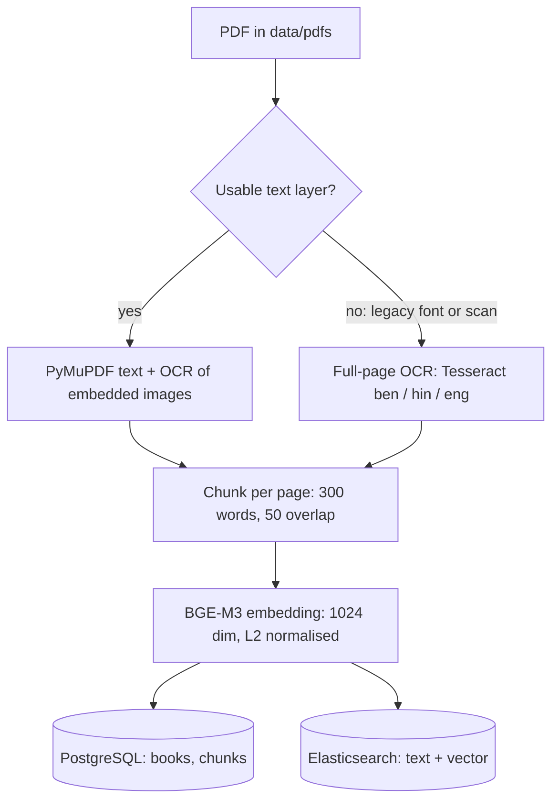

**Search** (question to highlighted answer):

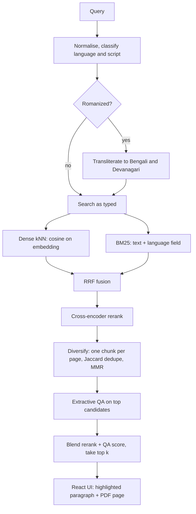

* **Ingestion** (`src/ingest.py`, helpers in `src/utils.py`) runs once or as a watcher over `data/pdfs/`.
* **Search** (`src/search.py`, model-free helpers in `src/ranking.py` and `src/translit.py`) is called by the
  FastAPI server (`src/api_server.py`), which also serves the PDFs under `/data`.
* **Frontend** (`frontend/`) is a React app; the page viewer is an `<iframe>` on `pdf_link#page=N`.

---

## 3. Tech stack, libraries and models

### Services

| Component | Version | Role |
|---|---|---|
| Elasticsearch | 8.10.4 (Docker) | Dense vector index (`dense_vector`, cosine) and BM25 with Bengali/Hindi/English analyzers. Security disabled, single node. |
| PostgreSQL | 15 (Docker, host port 5433) | Book and chunk metadata; source of truth for re-indexing. |
| Tesseract OCR | 5.3.4 with `eng`, `ben`, `hin` packs | OCR for embedded images and for books with an unusable text layer. |
| Docker Compose | — | Starts Postgres and Elasticsearch. |

### Models (all run locally)

| Model | Size on disk | Purpose | License |
|---|---|---|---|
| `BAAI/bge-m3` | 4.3 GB | Multilingual dense embeddings (1024-d); embeds chunks and queries | MIT |
| `BAAI/bge-reranker-v2-m3` | 2.2 GB | Cross-encoder reranker, scores (query, chunk) pairs | Apache-2.0 |
| `deepset/xlm-roberta-large-squad2` | 4.2 GB | Extractive question answering (finds the answer span) | CC-BY-4.0 |
| `Singla0009/all-indic-transliteration` (IndicXlit, CTranslate2 build) | 45 MB | Romanized → Bengali / Devanagari transliteration | MIT |

### Python libraries (installed versions)

| Library | Version | Used for |
|---|---|---|
| `elasticsearch` | 8.10.1 | Index, kNN and BM25 queries, bulk indexing |
| `psycopg2-binary` | 2.9.11 | PostgreSQL access |
| `PyMuPDF` | 1.27.2 | PDF text extraction and page rendering for OCR |
| `pytesseract`, `Pillow` | 0.3.13, 12.2.0 | OCR wrapper and image handling |
| `sentence-transformers` | 5.4.1 | BGE-M3 embedder and the `CrossEncoder` reranker |
| `transformers`, `sentencepiece` | 4.57.6, 0.2.1 | QA pipeline and tokenizers (a windowed fallback QA runner is included) |
| `torch` | 2.11.0 | Model inference (CUDA or CPU) |
| `ctranslate2` | 4.8.2 | Fast transliteration inference on CPU, no PyTorch needed |
| `numpy` | 2.4.4 | MMR, score fusion maths |
| `fastapi`, `uvicorn`, `pydantic` | 0.136.0, 0.44.0, 2.13.1 | HTTP API |
| `huggingface_hub` | 0.36.2 | Model download |
| `tiktoken`, `protobuf`, `tqdm` | 0.12.0, 7.34.1, 4.67.3 | Tokenizer and utility dependencies |
| `pytest` | 9.1.1 | Unit tests |
| `matplotlib` *(docs only)* | — | Regenerates the graphs in this README; not needed to run the engine |

### Frontend

React 19, TypeScript 6, Vite 8, Tailwind CSS 3, `lucide-react` icons. Vite 8 needs Node 20.19+ or 22.12+.

---

## 4. Ingestion pipeline

```
PDF → text (or OCR) → per-page word chunks → embeddings → PostgreSQL rows + Elasticsearch documents
```

1. **Discovery and change detection.** `data/pdfs/*.pdf` is scanned (once with `--once`, or polled every
   `POLLING_INTERVAL_SECONDS`). Each file is keyed by path and a SHA-256 content hash. A changed file is deleted
   (Postgres cascade + Elasticsearch `delete_by_query`) and re-ingested. `--only NAME...` restricts a run to files whose name
   contains one of the substrings.
2. **Text extraction.** PyMuPDF reads the text layer; images embedded in a page are OCRed with Tesseract.
3. **Unusable text layers → full-page OCR.** Many Bengali and Hindi textbooks store text in *legacy fonts*
   (Kruti Dev, Bijoy) or as scans, so PyMuPDF returns garbage (`izdk'k ijkorZu` instead of `प्रकाश परावर्तन`) or nothing.
   `utils.choose_ocr_language` samples about 12 pages, classifies each page's text layer, and if the book is mostly bad it renders
   every page at 300 DPI and OCRs it with `ben+eng` or `hin+eng` (chosen by probing the script). Books with a good text layer keep the
   old path. Details and thresholds are in [section 6.9](#69-text-layer-classification-ocr-fallback).
4. **Chunking.** Words are grouped into 300-word chunks with a 50-word overlap, **per page**, so `page_number` stays exact.
   A trailing fragment shorter than 40 words is merged into the previous chunk.
5. **Flags and language.** Each chunk gets `language_code` (`bn`/`hi`/`en`, by Unicode script) and an `is_exercise` flag
   (review questions, MCQ lists, `[LO x.y]` tags); exercise chunks are excluded from search.
6. **Embedding and storage.** BGE-M3 embeds each chunk (L2-normalised, 1024-d). Rows go to Postgres (`books`, `chunks`) and documents to
   Elasticsearch with `_id = book-{id}-chunk-{idx}`.
7. **Metadata** (title / author / year / department) is currently guessed from the filename and is poor for names with hyphens
   or underscores. Manual metadata entry is the first item on the [roadmap](#16-roadmap).

### Corpus

| Book | Language | Pages | Chunks | Extraction path |
|---|---|---|---|---|
| Balagurusamy, Programming in ANSI C | en | 854 | 1,031 | text layer |
| Reema Thareja, Data Structures | en | 557 | 1,123 | text layer |
| Data Structures (book 3) | en | 554 | 657 | scan: image OCR (English) |
| English Book | en | 482 | 946 | text layer |
| Quantum mechanics question bank (`qb.pdf`) | en | 310 | 753 | text layer |
| Free energy, Stereochemistry, Intermolecular force (notes) | en | 22 / 11 / 10 | 29 / 13 / 18 | text layer |
| General Science, Class IX | bn | 233 | 349 | **full-page OCR** (legacy font) |
| HSC Social Science, 1st paper | bn | 480 | 727 | **full-page OCR** (Bijoy) |
| West Bengal Class 7 Science | bn | 173 | 179 | **full-page OCR** (scan) |
| Biggyaner Itihas (History of Science) | bn | 394 | 604 | **full-page OCR** (scan) |
| Science Class 6 (Hindi) | hi | 136 | 211 | **full-page OCR** (Kruti Dev) |
| Science Class 7 (Hindi) | hi | 260 | 364 | **full-page OCR** (Kruti Dev) |
| NCERT Science Class X (Hindi), two editions | hi | 324 / 325 | 524 / 508 | **full-page OCR** (Kruti Dev / symbol font) |
| Vigyan Class 10 (Hindi, reduced) | hi | 360 | 570 | **full-page OCR** (Kruti Dev) |

---

## 5. How a search works, step by step

Every step names the setting that controls it (see [section 12](#12-configuration-reference)).

1. **Normalise the query.** Unicode NFC, invisible characters removed (soft hyphen, zero-width space, BOM; the joiners that Bengali and
   Hindi conjuncts need are kept), whitespace collapsed.
2. **Classify the query** (`translit.query_mode`):
   * *native script* or all words known English → **english** path;
   * contains Indic marker words (`kake`, `bole`, `kise`, `kehte`, `hain`, `kya`, …) → **romanized**;
   * Latin script, no marker words, but some word is unknown to the English vocabulary → **ambiguous** (a rare English term, a lone
     romanized word, or a mix such as "what is gati").
3. **Romanized queries** are transliterated word by word to Bengali and to Devanagari (IndicXlit); Assamese letters the model
   sometimes emits (`ৰ`) are mapped back to Bengali (`র`). The query as typed and both rewrites are all searched and fused. The embedder,
   reranker and QA use the single best spelling per word; BM25 gets the top `TRANSLIT_TOPK` (3) spellings. For **ambiguous** queries the
   typed query is searched first, and the rewrites are only added if the best rerank score is below `TRANSLIT_CONFIDENCE` (0.5); each
   chunk then keeps the higher of its two rerank scores.
4. **Two retrievals in Elasticsearch**, each returning `RETRIEVAL_CANDIDATES` (30) chunks:
   * **Dense kNN** on the BGE-M3 embedding, cosine similarity (the index is mapped `"similarity": "cosine"`; vectors are unit length, so
     cosine equals the dot product).
   * **BM25** over `text` plus the query language's analyzed subfield (`text.bn` / `text.hi` / `text.en`: stemming, stopwords, Indic
     normalisation). Question words ("what", "কী", "क्या", "परिभाषा"…) are stripped from the BM25 query, both spellings of nukta letters are
     included, and Bengali/Hindi queries only match chunks of the same language (`KEYWORD_SAME_LANGUAGE`).
5. **Fuse with Reciprocal Rank Fusion** (`HYBRID_MODE=rrf`): chunks are ranked by their ranks in the two lists, not by raw scores.
6. **Rerank** the fused candidates with the cross-encoder `bge-reranker-v2-m3` (`RERANK_ENABLED`). This is the most important quality step.
7. **Diversify:** keep the best chunk per (book, page), drop near-duplicates (Jaccard ≥ 0.8, for example another edition of the same
   text), then choose `top_k + QA_EXTRA_CANDIDATES` chunks with Maximal Marginal Relevance (`MMR_LAMBDA`).
8. **Extractive QA** on those chunks: `xlm-roberta-large-squad2` finds the most probable answer span. Long chunks are read in
   384-token windows with stride 128 so the answer is never cut off.
9. **Quote and paragraph.** The sentence containing the answer span becomes the quote; neighbouring sentences (up to about 140
   words) form the matched paragraph.
10. **Final score and order:** `(1 − w)·rerank + w·QA` with `QA_RANK_WEIGHT` w = 0.3; the best `top_k` (default 3) are returned.
11. **Display** (frontend): the paragraph is cleaned for reading (bullets become list items, stray spaces and control characters are
    removed), the quoted sentence is highlighted lightly and the exact QA answer phrase strongly. Answers with a QA score below 0.02
    are not highlighted, because they are near-random spans.

### API

| Endpoint | |
|---|---|
| `GET /health` | liveness check (`{status, version, admin_enabled}`) |
| `POST /api/search` `{query, top_k}` | returns `{exact_quote, book_title, author, department, page_number, pdf_link, paragraph_text, answer_text}` per result |
| `GET /data/pdfs/<file>.pdf` | PDFs from `PDF_DIR` only (opened by the page viewer at `#page=N`) |
| `GET /ready` | load-balancer health check: 200 when this copy can answer searches, else 503 with the failing check |
| `/api/admin/*` | admin API for the desktop admin app, behind `ADMIN_TOKEN` (see [section 11](#11-using-the-admin-app-step-by-step)) |

`/api/search` and `/data` follow the search access mode chosen in the admin app: **open** (anyone who can reach the server) or
**key** (an `X-API-Key` header, or `?key=` on PDF links, is required except for pages served by this server or from an allowed
origin). See [11.6.7](#1167-choose-who-may-search-and-give-apps-api-keys).

---

## 6. Mathematical reference

All formulas below are the ones the code uses (file names are given where the constants live).

### 6.1 Embedding normalisation and cosine similarity

Every chunk and query vector is scaled to unit length, $\hat v = v / \lVert v \rVert_2$ (`normalize_embeddings=True`). Cosine similarity is then a dot product:

$$\cos(q, d) = \frac{q \cdot d}{\lVert q \rVert\,\lVert d \rVert} = \hat q \cdot \hat d \in [-1, 1].$$

Elasticsearch ranks kNN hits by $\text{score}_{\text{kNN}} = \dfrac{1 + \cos(q,d)}{2}$, which is why raw dense scores look like 0.7–0.9.
Chunks are indexed with `dims = 1024`, `similarity = cosine`.

### 6.2 BM25 (keyword search)

Elasticsearch's default BM25 with $k_1 = 1.2$, $b = 0.75$:

$$\text{BM25}(D,Q) = \sum_{t \in Q} \text{IDF}(t)\cdot \frac{f(t,D)\,(k_1 + 1)}{f(t,D) + k_1\left(1 - b + b\,\frac{|D|}{\text{avgdl}}\right)},
\qquad \text{IDF}(t) = \ln\!\left(1 + \frac{N - n_t + 0.5}{n_t + 0.5}\right)$$

where $f(t,D)$ is the term frequency, $|D|$ the document length, $N$ the number of chunks and $n_t$ the number containing $t$.
The query is a `multi_match` of type `best_fields` over `text` and `text.<lang>` with tie-breaker $\tau = 0.3$:

$$\text{score}(D) = \max_f s_f(D) + \tau \sum_{f \neq f^*} s_f(D).$$

### 6.3 Reciprocal Rank Fusion

For ranked lists $i = 1..m$ with weights $w_i$ (dense $w=1$; BM25 $w=1$ by default, setting `RRF_KEYWORD_WEIGHT`) and constant $k = 60$:

$$\text{RRF}(d) = \sum_{i} \frac{w_i}{k + \text{rank}_i(d)}.$$

A chunk missing from a list contributes nothing for that list. RRF uses only ranks, so the incomparable score scales of cosine and BM25 do not matter.
For romanized queries the lists are the query as typed (weight `TRANSLIT_ORIGINAL_WEIGHT` $= 0.5$) and each script rewrite (weight $1$).

### 6.4 Cross-encoder reranking

The reranker reads the query and the chunk together and outputs a logit $z$, turned into a probability-like score

$$r(q,d) = \sigma(z) = \frac{1}{1 + e^{-z}} \in (0,1).$$

### 6.5 Diversification

*Near-duplicate removal* uses the Jaccard similarity of word sets, dropping a candidate when $J \ge 0.8$ against an already kept one:

$$J(A,B) = \frac{|A \cap B|}{|A \cup B|}.$$

*Maximal Marginal Relevance* picks, from the remaining candidates $R \setminus S$, the one maximising

$$\text{MMR}(d) = \lambda\,\widetilde{\text{rel}}(d) - (1-\lambda)\max_{s \in S}\cos(d, s), \qquad \widetilde{\text{rel}}(d) = \frac{\text{rel}(d)}{\max_{d'} \text{rel}(d')},$$

with $\lambda = 0.85$ (setting `MMR_LAMBDA`), relevance $= r(q,d)$ (negative scores are shifted to start at 0), and $\cos$ computed on the stored chunk embeddings. $\lambda = 1$ turns diversification off.

### 6.6 Extractive QA span

For a context of $n$ tokens the model gives start logits and end logits. With softmax probabilities $p^{s}_i$ and $p^{e}_j$ the answer span is

$$(\hat i, \hat j) = \arg\max_{0 \le j - i < 30}\; p^{s}_i\, p^{e}_j, \qquad \text{qa} = p^{s}_{\hat i}\, p^{e}_{\hat j}.$$

Long chunks are read in windows of 384 tokens with stride 128 and the best span over all windows is kept.

### 6.7 Final ranking score

$$\text{final}(d) = (1 - w)\, r(q,d) + w\,\text{qa}(d), \qquad w = 0.3 .$$

The weight $w$ is the setting `QA_RANK_WEIGHT`.

### 6.8 Chunking

With size $c = 300$ words and overlap $o = 50$ the chunk starts are $0, \; c - o, \; 2(c-o), \dots$ (a step of 250 words). If fewer than 40 words would remain after a
chunk, that chunk is extended to the end of the page instead of leaving a tiny fragment.

### 6.9 Text-layer classification (OCR fallback)

For a page with at least 80 non-space characters let $I$ be the share of Indic characters (U+0900–U+0DFF) and $O$ the share of non-ASCII characters outside
Indic and general punctuation. With $\text{sw}$ the share of English stopwords among the Latin tokens (needs at least 30 tokens):

$$\text{page is } \begin{cases} \text{good} & I \ge 0.3 \\ \text{bad} & O > 0.12 \\ \text{bad} & \text{sw} < 0.06 \\ \text{good} & \text{otherwise} \end{cases} \qquad (\text{fewer than 80 characters: "empty"}).$$

Legacy-font Hindi and Bengali are made of ordinary Latin letters, which is why the stopword share (real English prose is full of *the*, *of*, *and*; `izdk'k ijkorZu` is not) catches them.
The 12 sample pages are spaced evenly between 5 % and 95 % of the book. If good pages $\ge$ bad pages and at least one is good, the normal path is used. Otherwise 4 sample pages are OCRed
with `ben+hin+eng`, and with $b, h, l$ the Bengali, Devanagari and Latin letter counts:

$$\text{Indic book} \iff b + h > 0.3\,(b + h + l) \;\Rightarrow\; \text{OCR language} = \begin{cases} \text{ben+eng} & b \ge h \\ \text{hin+eng} & \text{otherwise.} \end{cases}$$

### 6.10 Romanized-query confidence fallback

Let $r_1$ be the best rerank score of an ambiguous query searched as typed. With $\theta = 0.5$ (setting `TRANSLIT_CONFIDENCE`), the script rewrites are searched only if $r_1 < \theta$. After reranking the new chunks against their rewrite, every chunk keeps its best score:

$$r(d) = \max\bigl(r_{\text{typed}}(d),\; r_{\text{rewrite}}(d)\bigr),$$

so a good English answer (typical $r \ge 0.4$) is never displaced by a junk rewrite, and a wrong $\theta$ only costs latency.

### 6.11 Evaluation metrics

With $N$ questions and $\text{rank}_i$ the position of the first correct (file, page) in question $i$'s results (the question has a set of accepted pages):

$$\text{hit@}k = \frac{1}{N}\sum_i \mathbb{1}[\text{rank}_i \le k], \qquad \text{MRR} = \frac{1}{N}\sum_i \frac{1}{\text{rank}_i} \;(0 \text{ if not found}),$$

$$\text{nDCG@}k = \frac{\text{DCG@}k}{\text{IDCG@}k}, \quad \text{DCG@}k = \sum_{p=1}^{k}\frac{\text{rel}_p}{\log_2(p+1)}, \quad \text{rel}_p \in \{0,1\}\ \text{(each accepted page counts once)}.$$

*Answer-keyword rate* is the share of questions whose top result's quote or paragraph contains the labelled keyword.

### 6.12 Score-spread statistics used in the experiments

For a ranked score list $s_1 \ge s_2 \ge \dots \ge s_k$ ($k = 30$):

$$z_1 = \frac{s_1 - \bar s_{2..k}}{\sigma_{2..k}}, \qquad \text{CV} = \frac{\sigma}{\mu}.$$

$z_1$ measures how far the top hit stands out from the rest; CV is the spread relative to the mean. They were tested as channel weights ([section 8.7](#87-experiment-variance-and-score-spread)).

### 6.13 Why a "soft" BM25 weight must be tiny under RRF

If the correct chunk is first in the dense list and the runner-up is second, their RRF gap from the dense list alone is

$$\Delta = \frac{1}{k+1} - \frac{1}{k+2} = \frac{1}{61 \cdot 62} \approx 2.6 \times 10^{-4}.$$

A runner-up that is also in the BM25 list at rank $r$ gains $w_{\text{BM25}}/(k + r)$. To keep the dense leader on top for $r = 1$ we need $w_{\text{BM25}} < \Delta\,(k+1) = \tfrac{1}{62} \approx 0.016$.
Any "moderate" weight (0.1–0.5) therefore still lets chunks that appear in both lists overtake a dense-only leader ([section 8.6](#86-experiment-soft-bm25-weight-for-cross-language-questions)).

---

## 7. Evaluation method

`tests/eval_search.py` runs **109 hand-labelled questions** (`tests/eval/questions.json`) against the live ingested corpus. Each question lists the accepted
`(file, pages)` and an answer keyword; `--validate` checks every label against the ingested text. Several books can legitimately answer the same question
(for example the three NCERT-based Hindi books), so all of them are accepted.

| Group | Questions | What it tests |
|---|---|---|
| `en` | 34 | English questions over the English books |
| `rare-en` | 9 | English questions with unusual words |
| `bn` | 12 | Bengali questions over the Bengali books |
| `hi` | 14 | Hindi questions over the Hindi books |
| `bn->en`, `hi->en` | 2 + 2 | Bengali/Hindi questions whose answer is in an *English* book (cross-language) |
| `roman-bn`, `roman-hi` | 12 + 14 | The same Bengali/Hindi questions typed in Latin letters |
| `mixed` | 10 | English sentence with a romanized word ("What is gati in Bengali science book?") |

Reports: hit@1/3/5, MRR, nDCG@3, the answer-keyword rate, hit@3 and seconds per query for every group, and the misses.

**Be careful how you read the numbers:**
* The Bengali, Hindi, romanized and mixed questions were written from sentences in the *same OCR text the engine searches*, mostly definitions in the books' own wording. They are easier than
  real user questions; read them as a ceiling.
* The cross-language groups have two questions each; one question is 50 points.
* With 109 questions, a difference of one or two questions (0.01–0.02) is noise.
* Retrieval-only runs (`--mode retrieval`) skip the reranker and the transliteration step.

---

## 8. Improvements and experiments, with results

### 8.1 Overview

| # | Change | Result |
|---|---|---|
| 1 | Hybrid retrieval, language analyzers, MMR, deeper QA (earlier work) | Retrieval-level ablation within noise; the reranker carries most of the accuracy ([8.2](#82-where-the-accuracy-comes-from)) |
| 2 | OCR fallback for unusable text layers | 9 Bengali/Hindi books became searchable ([8.3](#83-ocr-fallback-for-legacy-font-and-scanned-books)) |
| 3 | Romanized-query transliteration | Romanized Bengali 0.00 → 0.92, romanized Hindi 0.57 → 0.93 hit@3 ([8.4](#84-romanized-queries)) |
| 4 | Confidence fallback for ambiguous and mixed queries | Mixed 0.50 → 0.90, English unchanged ([8.5](#85-ambiguous-and-mixed-queries-confidence-fallback)) |
| 5 | Soft BM25 weight for cross-language questions | Helps only when the weight is below about 0.016 — **not adopted** ([8.6](#86-experiment-soft-bm25-weight-for-cross-language-questions)) |
| 6 | Score-spread (variance) weighting | No gain — **not adopted** ([8.7](#87-experiment-variance-and-score-spread)) |
| 7 | Frontend: highlighted, cleaned paragraph | Shipped ([8.8](#88-frontend-answer-highlighting)) |

### 8.2 Where the accuracy comes from

Retrieval alone (kNN + BM25 + RRF, no reranker) finds the right page in the top 3 for 64 % of questions; the full pipeline reaches 96 %. On every group that does not need transliteration the
cross-encoder reranker lifts hit@3 — for example Hindi from 0.71 to 1.00 and Bengali to an English book from 0.50 to 1.00.

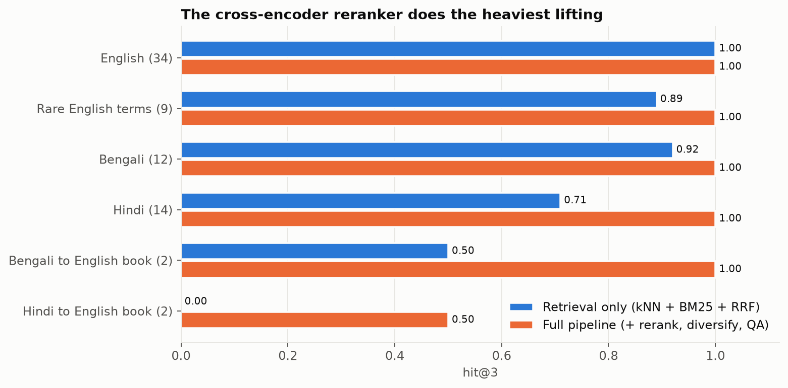

Switching individual retrieval features on and off (`--compare --mode retrieval`, 109 questions, run on CPU) moves hit@3 by at most 0.04 and MRR by 0.03, which is within noise:

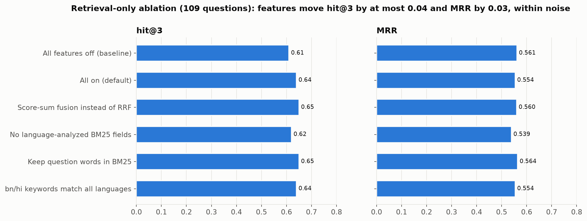

| Variant (retrieval only) | hit@1 | hit@3 | MRR |
|---|---|---|---|
| All features off (baseline) | 0.48 | 0.61 | 0.561 |
| All on (default) | 0.45 | 0.64 | 0.554 |
| Score-sum fusion instead of RRF | 0.46 | 0.65 | 0.560 |
| No language-analyzed BM25 fields | 0.43 | 0.62 | 0.539 |
| Keep question words in BM25 | 0.47 | 0.65 | 0.564 |
| bn/hi keywords match all languages | 0.45 | 0.64 | 0.554 |

*Honest reading:* at this level the hybrid features are not measurably better than the baseline. The language fields help a little (MRR 0.539 without them), RRF versus score-sum is a tie,
and dedupe/MMR and the extra QA candidates act after reranking, so they only show in `--mode full`, which was not re-run for each variant (about an hour per configuration).

### 8.3 OCR fallback for legacy-font and scanned books

Nine new Bengali/Hindi textbooks had no usable text layer. Ingesting them naively would have put garbage in the index:

| Book kind | What PyMuPDF returned | Example |
|---|---|---|
| Legacy-font Hindi (Kruti Dev) | Latin letters | `izdk'k ijkorZu ,oa viorZu` |
| Legacy-font Bengali (Bijoy) | Latin letters | `KvwRb weeván àeevwnK` |
| Symbol-font Hindi | dingbats | `✁✂✄☎✆✝` |
| Scans | nothing | (empty) |

The detector ([6.9](#69-text-layer-classification-ocr-fallback)) was checked on all 17 books: the 8 existing books are left on the old path (no OCR, no change) and all 9 new books are sent to the correct OCR language.
OCR text was spot-checked on a mid-book page of each: for example `অবস্থানের পরিবর্তনই গতি` and `इसे जूल का तापन नियम कहते हैं` come out as proper Unicode. OCR cost about 1.3 s per page on one thread; with 20 worker threads about 4 pages per second.
After ingestion the new books' chunks were tagged `bn`/`hi` correctly (almost no stray `en` chunks).

### 8.4 Romanized queries

Users type "Goti kake bole?" instead of "গতি কাকে বলে?". Before the change only 3 of 8 test queries found the right page: BM25 saw Latin letters and searched them as English, and the embedder only linked a word to its Bengali form by luck.

**Fix:** transliterate to Bengali and Devanagari with IndicXlit, search the query as typed and both rewrites together, and use all candidate spellings in BM25. A first test of the model on 20 words per language:

| | Right word first | Right word in top 3 | Time for 20 words |
|---|---|---|---|
| Bengali | 8 / 20 | 14 / 20 | 57 ms |
| Hindi | 13 / 20 | 18 / 20 | 40 ms |

Single-word accuracy is modest, which is why the design uses several spellings in BM25 and a script rewrite in embeddings, and fuses everything with the query as typed. On the 26 romanized evaluation questions:

| Group | Transliteration off | on |
|---|---|---|
| Romanized Bengali (12) | 0.00 | **0.92** |
| Romanized Hindi (14) | 0.57 | **0.93** |

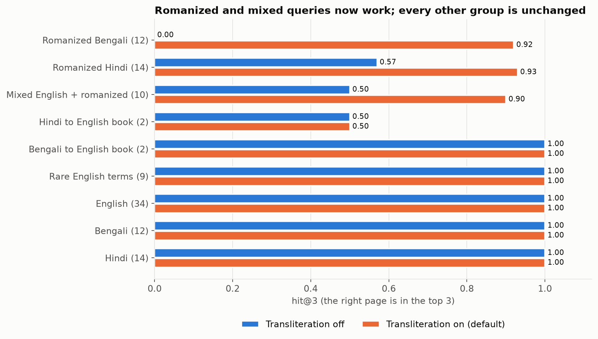

### 8.5 Ambiguous and mixed queries (confidence fallback)

A word the English vocabulary does not know could be a rare English term ("Zwitterion") or a lone romanized word ("vashpan"). Transliterating all of them added noise to English queries, so ambiguous queries are searched **as typed first**, and only
get the rewrites if the best rerank score is low. The score separates the cases well but not perfectly, so the design never depends on a sharp cut-off (see [6.10](#610-romanized-query-confidence-fallback)):

| Top rerank score of the query as typed | min | median | max |
|---|---|---|---|
| 34 real English questions | 0.41 | 0.99 | 1.00 |
| 26 romanized questions (searched as typed) | 0.00 | 0.01 | 0.83 (22 of 26 below 0.4) |
| Rare English terms present in the books | high, e.g. "Dijkstra algorithm" 0.999, "Chirality" 0.987 | | |
| Terms *absent* from the books | low, e.g. "Zwitterion" 0.004 | | |

Sweeping the threshold on all 109 questions (full pipeline):

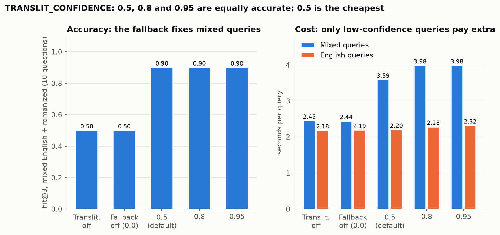

| Setting | hit@1 | hit@3 | MRR | Mixed hit@3 | Mixed s/query | English s/query |
|---|---|---|---|---|---|---|
| Transliteration off | 0.62 | 0.78 | 0.697 | 0.50 | 2.45 | 2.18 |
| Fallback off (θ = 0) | 0.76 | 0.93 | 0.839 | 0.50 | 2.44 | 2.19 |
| **θ = 0.5 (default)** | 0.81 | 0.96 | 0.881 | 0.90 | 3.59 | 2.20 |
| θ = 0.8 | 0.81 | 0.96 | 0.881 | 0.90 | 3.98 | 2.28 |
| θ = 0.95 | 0.81 | 0.96 | 0.881 | 0.90 | 3.98 | 2.32 |

All three thresholds are equally accurate; 0.5 does the least extra work. Only low-confidence queries pay for the second search:

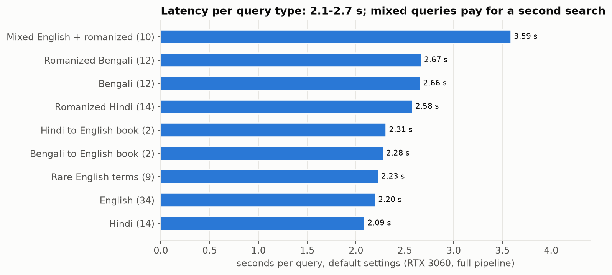

### 8.6 Experiment: soft BM25 weight for cross-language questions

**Problem (q25).** The Hindi question "विशिष्ट घूर्णन की परिभाषा क्या है?" ("what is the definition of specific rotation?") should find an *English* chemistry page. Dense search does find it — cosine 0.50 for the Hindi
question against 0.64 for the English one — but BM25 only matches Hindi books, which crowd the merge, and the reranker scores Hindi-versus-English at 0.004:

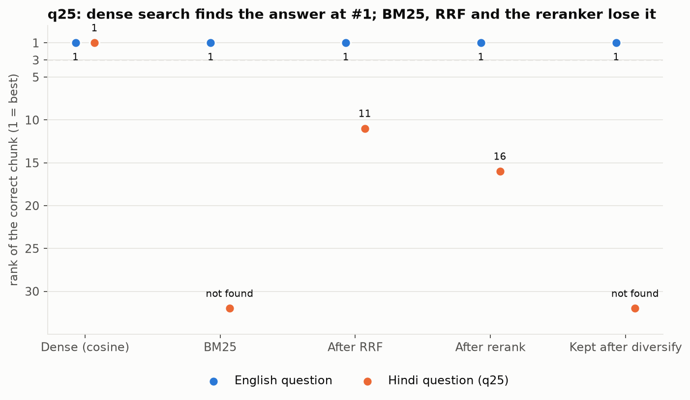

**Idea.** When the question's language differs from the top dense hit's language, give BM25 a lower weight (not zero) so both kinds of chunk still appear but the English chunk leads.
Rank of the correct chunk after the RRF merge:

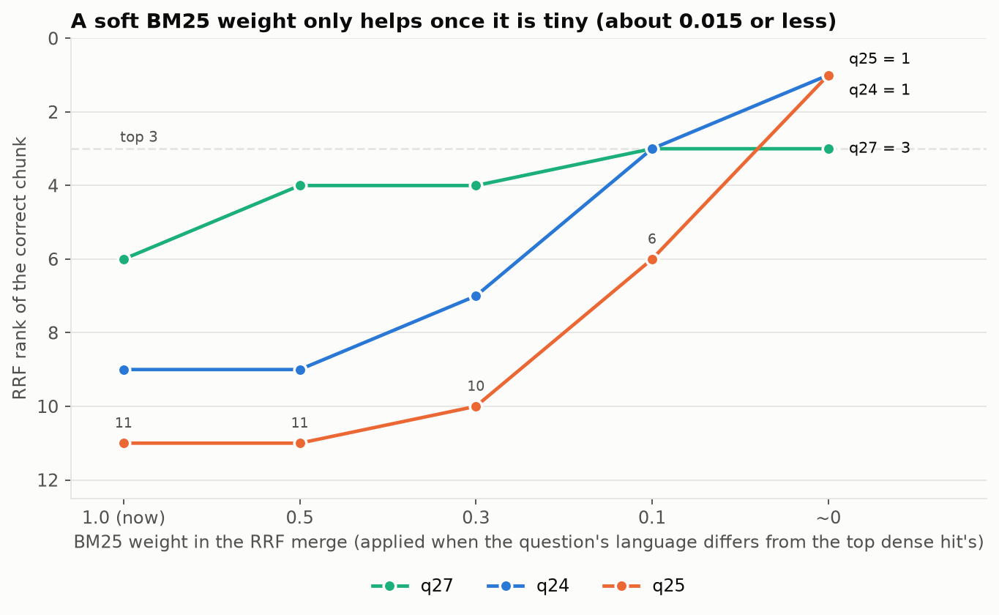

| BM25 weight | 1.0 (now) | 0.5 | 0.3 | 0.1 | ≈ 0 |
|---|---|---|---|---|---|
| q24 | 9 | 9 | 7 | 3 | 1 |
| q25 | 11 | 11 | 10 | 6 | 1 |
| q26 | 1 | 1 | 1 | 1 | 1 |
| q27 | 6 | 4 | 4 | 3 | 3 |

**Result.** It works in the right direction, but only when the weight is tiny; [6.13](#613-why-a-soft-bm25-weight-must-be-tiny-under-rrf) shows why the bound is about 0.016. The rule would also fire on 2 false alarms out of 6 triggers
(q53, q102). **Not adopted yet.** It needs more cross-language eval questions first; with 4 it cannot be validated.

### 8.7 Experiment: variance and score spread

**Idea.** Weight each retrieval channel by how decisive its scores are (like IDF rewards distinctive terms). The statistic is the z-score of the top hit ([6.12](#612-score-spread-statistics-used-in-the-experiments)).

**Result 1 — the signal is real.** The top hit tends to stand out more when it is correct. **Result 2 — it does not improve the merge.** Weighting RRF by $z_1$, by CV or by $z_1^2$ changed nothing measurable:

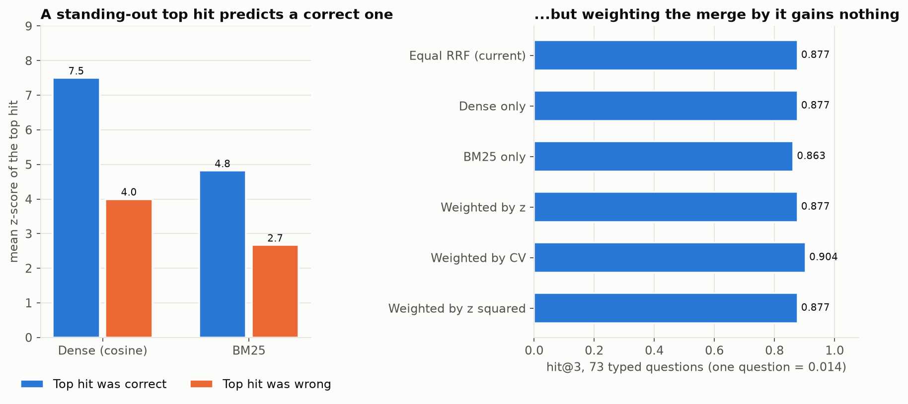

| Merge (73 typed questions, retrieval level) | hit@1 | hit@3 | hit@10 | MRR |
|---|---|---|---|---|
| Equal RRF (current) | 0.644 | 0.877 | 0.959 | 0.771 |
| Dense only | 0.671 | 0.877 | 0.945 | 0.778 |
| BM25 only | 0.630 | 0.863 | 0.959 | 0.745 |
| Weighted by z | 0.658 | 0.877 | 0.932 | 0.769 |
| Weighted by CV | 0.658 | 0.904 | 0.959 | 0.767 |
| Weighted by z² | 0.644 | 0.877 | 0.932 | 0.765 |

The CV result (0.877 → 0.904) is a one-question difference (one question = 0.014) with a lower MRR, so it is noise. For q25 the two channels looked equally confident ($z = 3.39$ dense, $2.64$ BM25): BM25 was
confidently matching the *wrong language*, and variance measures peakedness, not language.

**Where variance did help a little.** (a) When every rerank score of a query is flat and tiny, the reranker has no information, and falling back to the fused retrieval order lifted hit@1 from 0.822 to 0.836
and MRR from 0.895 to 0.902 — but that is one question (q102) and q25 stayed lost. (b) As a *trigger* for the language-mismatch rule above, the dense z-score separated the true cases ($z$ = 3.4, 4.6, 5.9, 12.7) from the two false alarms
($z$ = 2.7, 2.8), on six questions. Both are recorded as ideas, not adopted features.

| Flat-reranker fallback | hit@1 | hit@3 | MRR | queries affected |
|---|---|---|---|---|
| Always rerank (current) | 0.822 | 0.973 | 0.895 | 0 |
| Fused order if max rerank < 0.05 | 0.836 | 0.973 | 0.902 | 2 |
| Fused order if max rerank < 0.10 | 0.836 | 0.973 | 0.902 | 2 |
| Fused order if max rerank < 0.20 | 0.822 | 0.959 | 0.891 | 4 |

### 8.8 Frontend: answer highlighting

The result card used to print the matched paragraph as raw text, with no highlight and with book noise (bullet glyphs, spaces before punctuation, stray numbers). Now the card shows only the paragraph: the quoted sentence is lightly highlighted and the exact QA answer phrase
strongly highlighted, the surrounding text is muted, and the page number sits in the card header. Display cleanup (in `frontend/src/lib/textFormat.ts`) turns bullet glyphs into list items, removes spaces before punctuation and control characters
(keeping the zero-width joiners Bengali and Hindi need), and drops a lone page-number-like token at the edge of the excerpt. `*` is only treated as a bullet before Bengali/Hindi text, because it means pointer or multiplication in the programming books.
The API sends the QA span as `answer_text`.

### 8.9 Eval-set growth over the project

Each row is a different question set, so the rows are not directly comparable; they show what each change did on the set that existed at the time.

| Stage | Questions | hit@1 | hit@3 | MRR |
|---|---|---|---|---|
| Original English corpus | 38 | 0.89 | 0.97 | 0.930 |
| After widening one over-narrow label (q37) | 38 | 0.92 | 1.00 | 0.956 |
| After ingesting 9 Bengali/Hindi books | 38 | 0.87 | 0.97 | 0.917 |
| + 26 native Bengali/Hindi questions | 64 | 0.86 | 0.98 | 0.919 |
| + 26 romanized questions, transliteration off | 90 | 0.66 | 0.79 | 0.719 |
| + 26 romanized questions, transliteration on | 90 | 0.82 | 0.97 | 0.891 |
| + 10 mixed, 9 rare-English (final, default settings) | 109 | 0.81 | 0.96 | 0.881 |

---

## 9. Current accuracy and known limits

**Final run (109 questions, default settings):** hit@1 0.81, hit@3 0.96, MRR 0.881, top-1 quote contains the labelled keyword 0.76. Every group is at 1.00 hit@3 except `roman-bn` 0.92, `roman-hi` 0.93, `mixed` 0.90 and `hi->en` 0.50.

**The four misses:**
* **q25** — Hindi question about an English book (cross-language; see [8.6](#86-experiment-soft-bm25-weight-for-cross-language-questions)).
* **q74** — a long romanized Bengali sentence ("Prakritik sompod kokhon sompotti bole gonno hoy?").
* **q80** — "Enzyme kise kahte hain?" returns other enzyme pages instead of the labelled definition.
* **q91** — "What is gati in Bengali science book?": the model spells *gati* as `গাতি` and mixed-script queries score very low in the reranker; the top result is a correct Hindi definition, but the label asks for the Bengali book.

**Limits you should know about:**
* **The accuracy number is optimistic** ([section 7](#7-evaluation-method)). Real, independently written questions will score lower.
* **Quote quality is weaker than page retrieval.** Only 76 % of top results contain the labelled keyword; some quotes are fragments ("a pointer variable.") or noisy OCR text, and sentence splitting can break after a section number ("7. 1 INTRODUCTION").
* **Cross-language retrieval** (a Hindi/Bengali question about an English book) is unreliable and measured on only 4 questions.
* **Book metadata is wrong** for many books (title "DATA", author "STRUCTURE"), because it is guessed from file names.
* **OCR errors** in conjunct letters and scientific terms; three Hindi books overlap heavily, so near-duplicate results can appear.
* **Terms that are not in any book** return unrelated junk (and, for ambiguous queries, pay the extra search).
* **Transliteration is inherently ambiguous** (`gati` → `গাতি`/`গতি`); several spellings are tried but some queries will miss.
* **Latency** is 2–4 s per query on a 12 GB GPU; the reranker alone is about 1.5 s.

---

## 10. Setup and usage

### Prerequisites

* Linux or macOS with Python 3.10+ (3.12 used here), Docker with the Compose plugin, Node.js 20.19+ or 22.12+ with npm, and Tesseract OCR with the `eng`, `ben` and `hin` language packs.
* A GPU is optional (`INFERENCE_DEVICE=cpu` works, slowly). The models need about 12 GB of disk.

### Quick start

```bash
./setup.sh                 # venv, Python deps, Docker (Postgres + Elasticsearch), schema, models, frontend deps
# put PDFs in data/pdfs/
./ingestion.sh --once      # ingest new or changed PDFs (omit --once to keep watching)
.venv/bin/python src/build_english_vocab.py   # refresh the English word list used for romanized-query detection
./api.sh                   # FastAPI on :8000
cd frontend && npm run dev # UI on http://localhost:5173 (proxies /api, /health, /data to :8000)
```

`setup.sh` also installs the system packages (`tesseract-ocr-eng`, `-ben`, `-hin`) when `apt-get` is available. If it cannot, install them yourself:

```bash
sudo apt install tesseract-ocr tesseract-ocr-eng tesseract-ocr-ben tesseract-ocr-hin
```

### Common commands

| Task | Command |
|---|---|
| Ingest new PDFs once | `./ingestion.sh --once` |
| Ingest only matching files | `./ingestion.sh --once --only "Bigyan" "HINDI-6TH"` |
| Watch the folder | `./ingestion.sh` |
| CLI search | `.venv/bin/python src/search.py --query "What is a pointer variable?"` |
| Initialise or upgrade schema | `.venv/bin/python src/db_init.py` (idempotent) |
| Fill language subfields on old data | `.venv/bin/python src/reindex_es.py` (`--all` re-indexes everything) |
| Re-apply the exercise heuristic | `.venv/bin/python src/backfill_exercise_flags.py [--dry-run --samples 3]` |
| Download models | `.venv/bin/python src/download_models.py` |
| Frontend lint and build | `cd frontend && npm run lint && npm run build` |

Always use the `.venv` interpreter or the wrapper scripts; the files in `src/` use flat imports (`from config import settings`), so run them as files, not as `python -m src.x` (uvicorn is the exception).

### Admin app

`admin/` is the desktop admin app. It lets you fix book details, add and delete books, run ingestion, test searches, change
settings, decide who may search and hand out API keys, for a server on the same computer or anywhere else. Installing it and the
three ways to run OSISS (one computer, campus network, public website) are described step by step in
[section 11](#11-using-the-admin-app-step-by-step).

### Upgrading an existing install

* Run `db_init.py` to add new columns and the Elasticsearch subfields, then `reindex_es.py` once to fill the `text.bn|hi|en` fields (in place, no re-embedding). The API also creates the admin tables (`excluded_files`, `api_clients`) at startup.
* Add `ADMIN_TOKEN=<long random value>` to `.env` (or rerun `./setup.sh`) to enable the admin app.
* `docker-compose.yml` now publishes PostgreSQL (5433) and Elasticsearch (9200) on `127.0.0.1` only. Run
  `docker compose up -d postgres elasticsearch` once to apply it. Nothing in OSISS needs them from another machine.
* Changing the Elasticsearch mapping or the embedding dimension generally means recreating the index and re-ingesting; chunk-boundary changes only affect books that are re-ingested.

---

## 11. Using the admin app, step by step

The admin app (`admin/`) is a desktop program for whoever runs OSISS. With it you can:

* fix book titles and other details;
* add, delete and restore books;
* run and watch ingestion;
* test searches;
* change search settings without a restart;
* decide who may use search;
* hand out API keys to other apps.

It can control a server on the same computer or one anywhere else.

Pick the setup that matches how you will run OSISS, do the two common steps first (11.1 and 11.2), then follow your setup:

| Setup | Who searches | Where the server runs | Admin app runs on |
|---|---|---|---|
| [A. One computer](#113-setup-a-everything-on-one-computer) | people at that computer | the same computer | the same computer |
| [B. Campus network](#114-setup-b-a-server-on-the-campus-network) | everyone on the campus network | a server on the campus network | an admin's PC on the same network |
| [C. Public website](#115-setup-c-a-public-website-on-your-own-domain) | everyone on the internet | a server with a public IP and your domain (e.g. `ossis.com`) | an admin's PC anywhere |

[11.6](#116-everyday-tasks) covers the day-to-day tasks, [11.7](#117-how-the-app-and-the-server-are-protected) how the app
and the server are protected, [11.8](#118-capacity-and-load) how many searches a server can take and how to protect it
from overload, and [11.9](#119-running-several-copies) how to run several copies (one machine, several machines, or AWS).

> The screenshots come from a demo server with two sample PDFs and no Elasticsearch or models installed. That is why the
> Dashboard shows Elasticsearch as down and the models as missing, and why the scores and timings in the search console screenshot are
> illustrative. On a real install those tiles are green.

### 11.1 Install the admin app

The app is built from source (Node.js 20.19+ or 22.12+):

```bash
cd admin
npm install
npm run dist          # Linux: admin/release/OSISS Admin-1.0.0.AppImage and osiss-admin_1.0.0_amd64.deb
```

* **Debian/Ubuntu:** `sudo apt install ./release/osiss-admin_1.0.0_amd64.deb`, then start *OSISS Admin* from the applications menu.
* **Other Linux:** `chmod +x "release/OSISS Admin-1.0.0.AppImage"` and run it.
* **Windows / macOS:** run `npm run dist:win` on a Windows PC or `npm run dist:mac` on a Mac (installers are built on their own
  system). These builds are configured but have only been tested on Linux so far. Starting and stopping services from the
  Dashboard needs Linux or macOS.
* **While developing the app:** `npm run dev` opens it with live reload.

The built installer contains no server address or secret. Copy it to every admin PC.

### 11.2 First launch: create your passkey

1. Open the app and click **Create my passkey**.
2. The app shows a random 6-character passkey, for example `KE9-YZD`. Write it down and keep it safe. It is shown only once.
3. Type it back into **Type it back to confirm** (upper or lower case, with or without the dash) and click **Confirm and continue**.

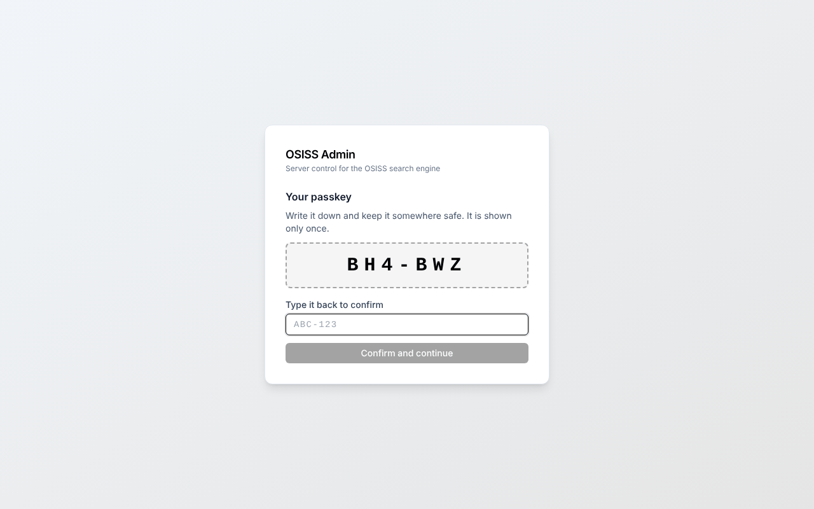

From now on the app asks for the passkey every time it opens (and after 15 minutes without use). If you forget it, see
[11.6.8](#1168-lock-the-app-change-the-passkey-or-reset).

### 11.3 Setup A: everything on one computer

Use this to try OSISS, or when only the people at one computer will search.

1. **Install the server:** in the OSISS folder run `./setup.sh`. Among other things it writes a random `ADMIN_TOKEN` into `.env`.
   That token is what lets the admin app control the server.
2. **Add your PDFs (optional now):** copy them into `data/pdfs/`. You can also add them later from the app (see
   [11.6.2](#1162-add-a-book)).
3. **Start the API once by hand to check it:** `./api.sh`. Later you can start and stop it from the app's Dashboard instead.
4. **Open the admin app** and create your passkey ([11.2](#112-first-launch-create-your-passkey)). The **Add a server** form opens.
5. Fill in the form:
   * **Name:** `This computer`.
   * **Where does the server run?:** *On this computer (can start / stop it)*.
   * **Server URL:** `http://localhost:8000`.
   * **OSISS folder on this computer:** click **Browse** and pick the OSISS folder.
6. Click **Read token from .env**. The app reads `ADMIN_TOKEN` from the folder's `.env` file, so you never have to copy it by hand.
7. Click **Save & test connection**. You should see *Connected: OSISS …, admin token accepted*.

   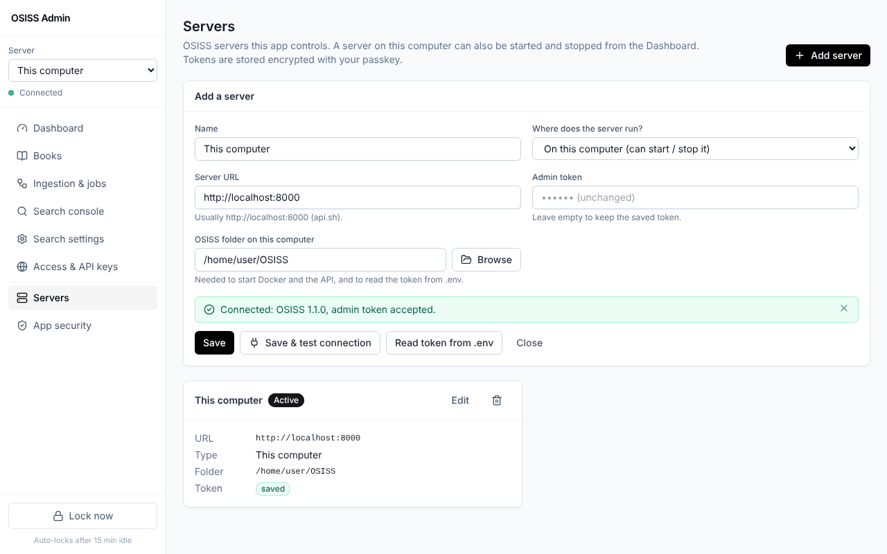

8. Open **Dashboard**. The app asks how search should be served. For one computer choose **Open — everyone who can reach the
   server** and click **Save choice** ([11.6.7](#1167-choose-who-may-search-and-give-apps-api-keys) explains both choices).

   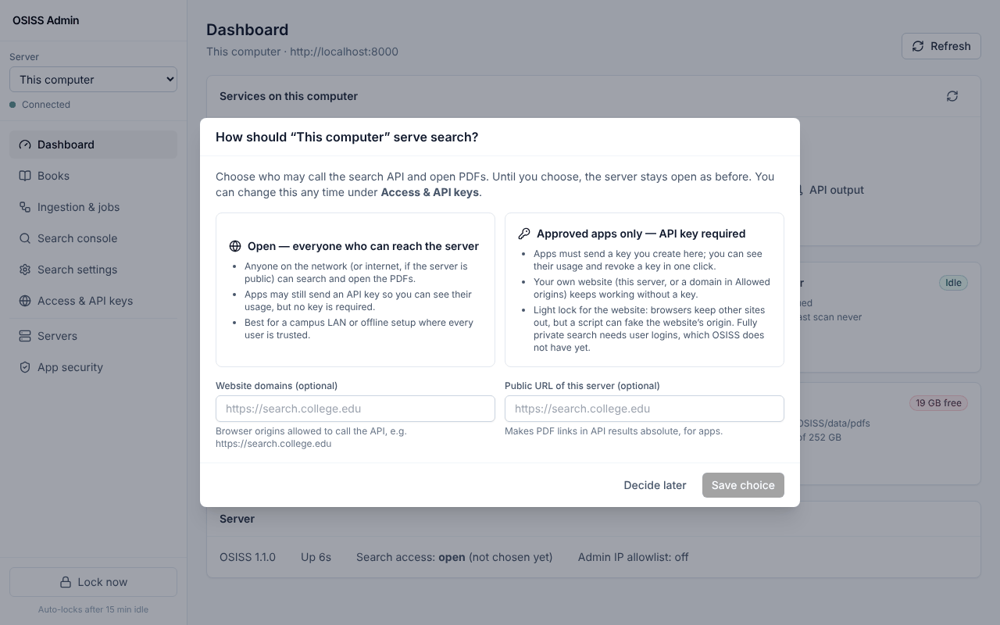

9. The **Services on this computer** panel can start and stop PostgreSQL + Elasticsearch (**Start** / **Stop**) and the API
   (**Start API** / **Stop API**). An API started from the app keeps running after you close the app. **API output** shows its log.
   The tiles below show the health of every part of the server.

   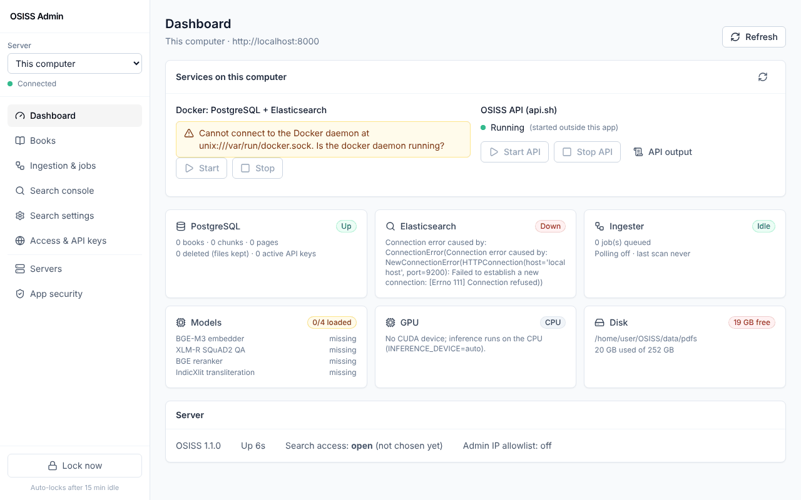

10. **Ingest the PDFs:** open **Ingestion & jobs** and click **Scan now**, or switch on **Poll the PDF folder** so new files in
    `data/pdfs/` are picked up every few seconds. Then fix the guessed titles ([11.6.1](#1161-fix-a-guessed-title)).
11. **Search:** run the website with `cd frontend && npm run dev` and open <http://localhost:5173>. Or build it once
    (`npm run build`), add `SERVE_FRONTEND=true` to `.env`, restart the API and open <http://localhost:8000>.

### 11.4 Setup B: a server on the campus network

One machine runs OSISS for everyone on the campus network; an admin manages it from their own PC.

**On the server**

1. Install OSISS and run `./setup.sh`, then ingest the PDFs (`./ingestion.sh --once`, or later from the app).
2. Serve the website from the API so students only need a browser:

   ```bash
   cd frontend && npm install && npm run build && cd ..
   echo "SERVE_FRONTEND=true" >> .env
   ```

3. Let only the admin PC use the admin API: add its address to `.env`, e.g. `echo "ADMIN_ALLOWED_IPS=192.168.1.50" >> .env`.
   Several addresses or ranges are separated by commas (`192.168.1.50,10.0.0.0/24`).
4. Keep the API running across reboots with the systemd service in `deploy/osiss-api.service`. Change `User` and the `/opt/OSISS`
   paths to yours, and set `Environment=API_HOST=0.0.0.0` so the campus network can reach it. Then run:

   ```bash
   sudo cp deploy/osiss-api.service /etc/systemd/system/
   sudo systemctl daemon-reload && sudo systemctl enable --now osiss-api
   ```

5. Note the server's address (`hostname -I`, e.g. `192.168.1.20`) and the token (`grep ADMIN_TOKEN .env`). Give the token to the
   admin in person or over a secure channel, not by email.

Students now open `http://192.168.1.20:8000` in a browser.

**On the admin PC**

6. Install the app ([11.1](#111-install-the-admin-app)) and create a passkey ([11.2](#112-first-launch-create-your-passkey)).
7. In **Servers**, click **Add server** and fill in:
   * **Where does the server run?:** *Elsewhere (a domain or another machine)*.
   * **Server URL:** `http://192.168.1.20:8000`.
   * **Admin token:** paste the token.
   * Tick **Allow plain http:// to this server**. Without HTTPS the token travels unencrypted, which is acceptable only on a
     network you trust. To avoid it, put Caddy in front as in Setup C, with an internal certificate.

   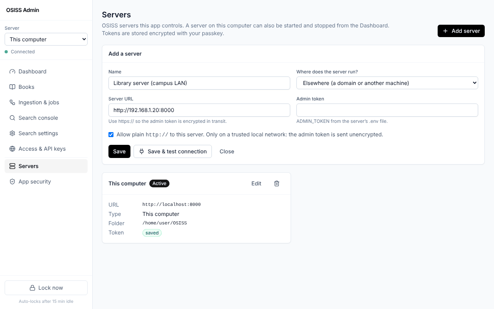

8. Click **Save & test connection**, then open **Dashboard** and choose the access mode (usually **Open** on a campus network).

Start, stop and restart the server on the server itself (`sudo systemctl restart osiss-api`). The Dashboard's start/stop buttons
only work for *This computer* servers. Everything else in the app works the same for a remote server.

### 11.5 Setup C: a public website on your own domain

This makes search available to everyone on the internet at an address such as `https://ossis.com`. You need:

* **A domain you own.** Check that the name is free and register it.
* **A server that is always on**, with a public IP address. It can be your own machine or a cloud VM. It needs enough memory for the
  models (16 GB RAM or more; a GPU makes searches much faster).
* **Ports 80 and 443 open** to the internet (for HTTPS) and port 22 for SSH. Nothing else.

**On the server** (Ubuntu shown; run as a user with `sudo`)

1. Create a user and install OSISS in `/opt/OSISS`:

   ```bash
   sudo useradd -m -s /bin/bash osiss && sudo usermod -aG docker osiss
   sudo git clone https://github.com/midyadebangshu-spec/OSISS /opt/OSISS && sudo chown -R osiss: /opt/OSISS
   sudo -iu osiss bash -c 'cd /opt/OSISS && ./setup.sh'
   ```

   `docker-compose.yml` publishes PostgreSQL and Elasticsearch on `127.0.0.1` only, so they are never reachable from the internet
   even though Docker bypasses host firewalls.
2. Build the website: `sudo -iu osiss bash -c 'cd /opt/OSISS/frontend && npm run build'`.
3. Install the API service. `deploy/osiss-api.service` already sets `API_HOST=127.0.0.1` (only the proxy on this machine may reach
   the API) and `SERVE_FRONTEND=true`:

   ```bash
   sudo cp /opt/OSISS/deploy/osiss-api.service /etc/systemd/system/
   sudo systemctl daemon-reload && sudo systemctl enable --now osiss-api
   curl http://127.0.0.1:8000/health          # {"status":"ok",...}
   ```

4. **DNS:** at your domain registrar, create an `A` record for `ossis.com` (and `www` if you want it) pointing to the server's
   public IP. Wait until `ping ossis.com` shows that IP.
5. **HTTPS with Caddy:** install Caddy (<https://caddyserver.com/docs/install>), then:

   ```bash
   sudo cp /opt/OSISS/deploy/Caddyfile.example /etc/caddy/Caddyfile
   sudo nano /etc/caddy/Caddyfile     # replace ossis.example.com with your domain, 203.0.113.10 with the admin PC's public IP
   sudo systemctl reload caddy
   ```

   Caddy gets and renews the HTTPS certificate on its own. The example also answers `403` to `/api/admin/*` from any other address,
   so the admin API is not exposed to the internet. Remove that block if admins connect from changing addresses (the token and its
   lockout still protect it).
6. **Firewall:** `sudo ufw allow 22,80,443/tcp && sudo ufw enable`.
7. Open `https://ossis.com` in a browser: the search page should load and answer questions.

**On the admin PC**

8. In the app, **Add server** with *Elsewhere*, URL `https://ossis.com` and the token from `/opt/OSISS/.env`. Leave
   *Allow plain http://* unticked. **Save & test connection**.
9. In **Access & API keys**, decide who may search ([11.6.7](#1167-choose-who-may-search-and-give-apps-api-keys)) and enter
   `https://ossis.com` as **Public URL of this server**, so PDF links in API results are complete addresses that apps can open.
   If the website is hosted somewhere else than this server, add that site's address under **Website domains**.
10. Give each app that should use the search its own API key (also [11.6.7](#1167-choose-who-may-search-and-give-apps-api-keys)).

Before going public, consider:

* **Licences:** with open access, anyone can download every PDF. Make sure the books may be shared that way.
* **Capacity:** one API process holds one copy of the models, and searches that arrive together share it. Measure how many searches
  your server answers before announcing the site, and set a per-IP rate limit for the public. Both are covered in
  [11.8](#118-capacity-and-load). Serving heavy public traffic needs several API copies behind a load balancer
  ([11.9](#119-running-several-copies)), or the AWS deployment in [deploy/aws](deploy/aws/README.md).
* **Updates:** to update, run `git pull`, then `sudo systemctl restart osiss-api`, and rebuild the website if `frontend/` changed.

### 11.6 Everyday tasks

#### 11.6.1 Fix a guessed title

Books added from `data/pdfs/` get their title and author from the file name, which is often wrong. Those books are marked
**guessed** in **Books**, and **Only the … with guessed titles** lists just them.

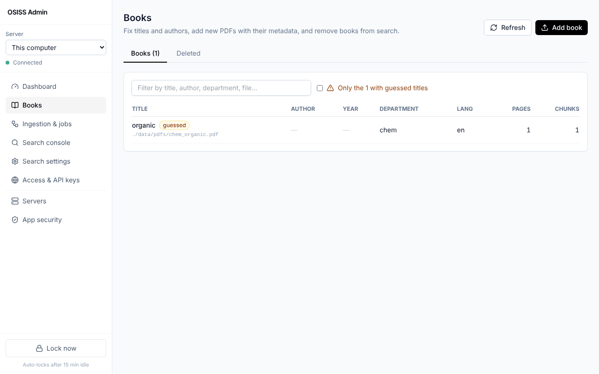

1. Click the book.
2. Correct **Title**, **Author**, **Year** and **Department**.
3. Click **Save metadata**.

The change is written to both databases at once, so search results show it immediately; nothing is re-read or re-embedded. **Open
PDF** shows the book to check its cover.

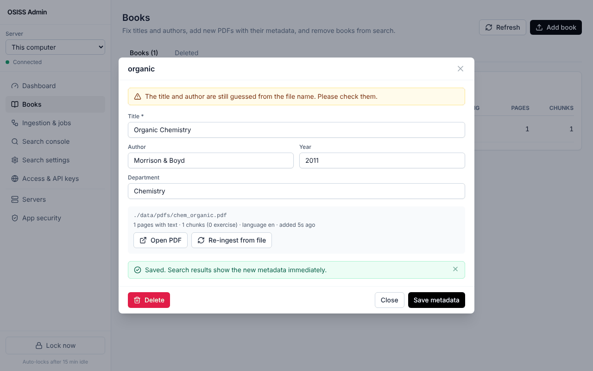

#### 11.6.2 Add a book

1. In **Books**, click **Add book**, then **Choose PDF…**.
2. The fields are pre-filled from the file name. Correct them.
3. Click **Upload and ingest**.

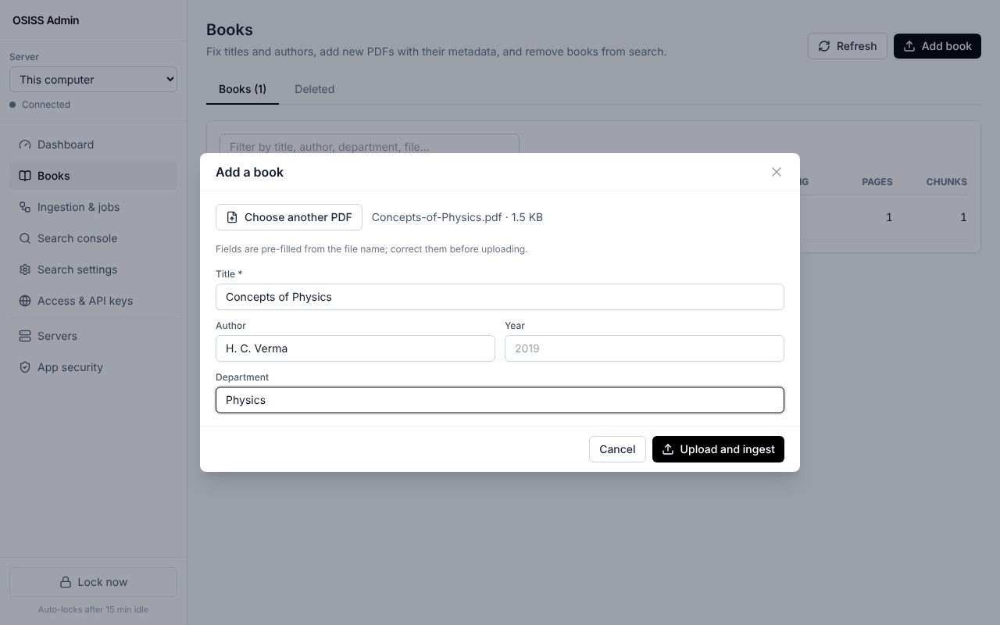

The PDF is copied to the server's `data/pdfs/` and ingested with the details you entered. Scanned or legacy-font Bengali/Hindi books
are OCRed, which can take several minutes. You can close the window: the job continues on the server and appears under
**Ingestion & jobs**. Uploading a PDF that is already in the library is refused.

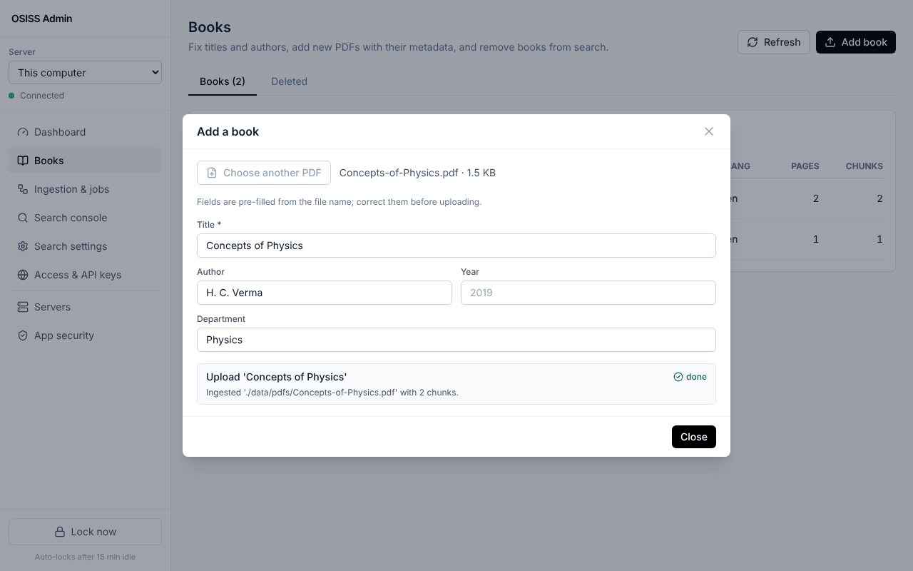

#### 11.6.3 Delete and restore a book

1. Open the book and click **Delete**.
2. Confirm.

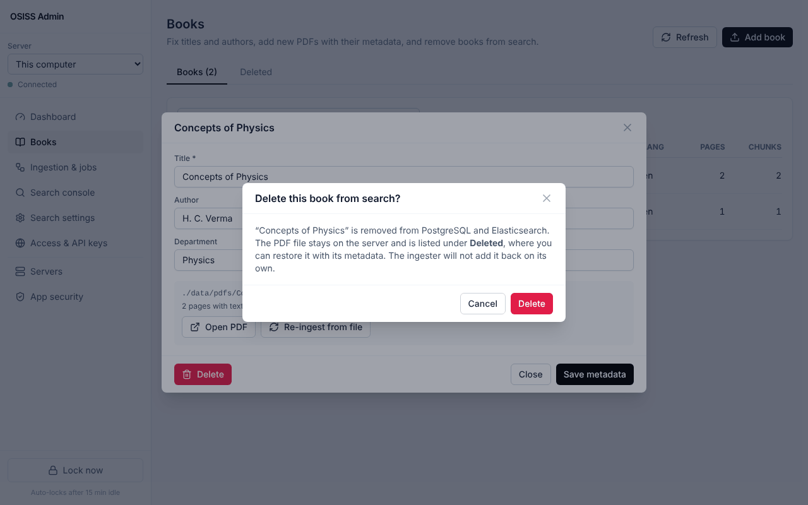

The book disappears from search, but its PDF stays on the server and is listed under **Books → Deleted**. The ingester will not
add it back by itself. **Restore** ingests it again with the details it had.

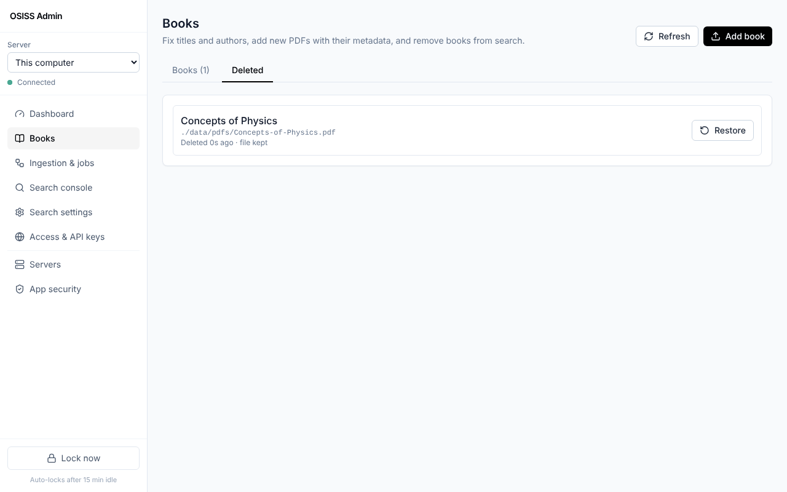

**Re-ingest from file** (in the book window) reads the PDF again and keeps its details. Use it after replacing the file or changing
the ingestion settings.

#### 11.6.4 Ingestion, jobs and maintenance

The **Ingestion & jobs** page has these controls:

* **Poll the PDF folder:** checks `data/pdfs/` every few seconds for new or changed PDFs. The setting is kept across restarts.
* **Scan now:** runs that check once.
* **Maintenance:** runs the upgrade and repair scripts (*Update database schema*, *Re-index language fields*, *Re-apply exercise
  flags*). Run them after upgrading OSISS when the release notes say so.
* **Jobs:** lists everything queued or done since the server started. A queued job can be cancelled.
* **Live log:** shows the progress, including OCR.

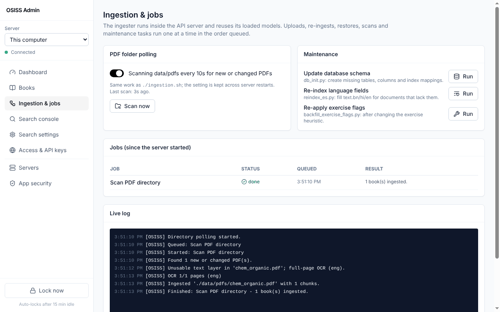

#### 11.6.5 Test a search

**Search console** runs the same search as the website and shows the scores for each result and the time each stage took. Use it to
check a new book, or to compare a setting before and after a change.

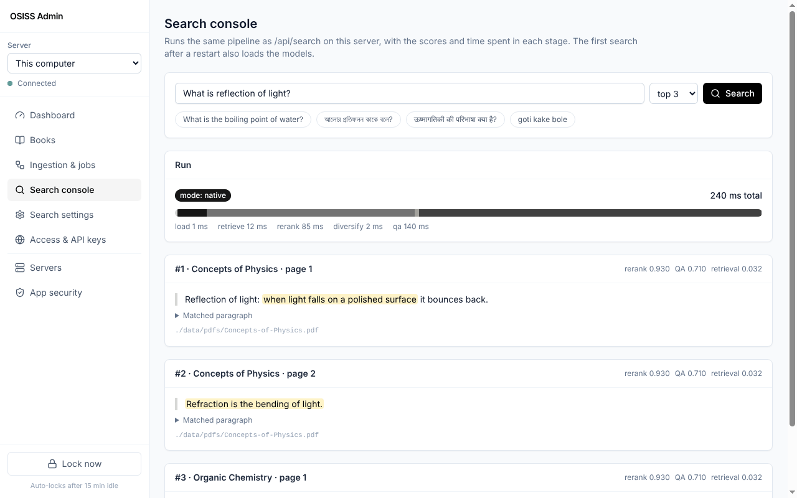

#### 11.6.6 Change search settings

**Search settings** lists the knobs the server reads on every search (reranking, QA weight, number of candidates, romanized queries,
…).

1. Change one or more values. Each changed value is marked *changed*.
2. Click **Save changes**. The change takes effect at once and is kept across restarts.
3. Try a few questions in the Search console, and use **Discard** or change the value back if results get worse.

Settings that need a restart (database addresses, model paths, …) are listed read-only at the bottom; change them in `.env`.
The **Load protection** group (answer cache, search queue, rate limits) is explained in [11.8](#118-capacity-and-load).

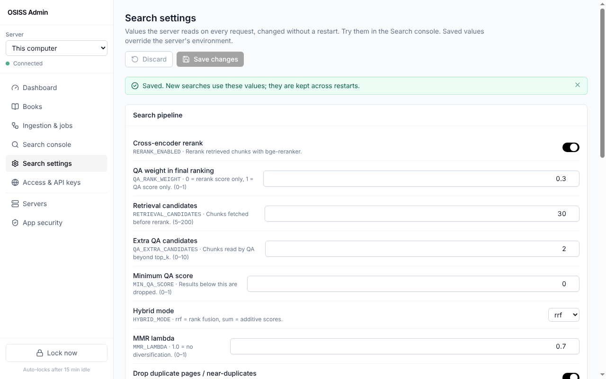

#### 11.6.7 Choose who may search and give apps API keys

In **Access & API keys** choose one of:

* **Open:** anyone who can reach the server can search and open PDFs. Apps may send a key so you can see their usage, but it is not
  required. Right for a campus network or one computer.
* **Approved apps only:** other apps must send an API key. Your own website (served by this server, or listed under **Website
  domains**) keeps working without one. This keeps other websites and unknown apps out. It cannot stop a determined person who
  copies how your website calls the API, because that would need user logins, which OSISS does not have yet.

**Website domains** lists browser sites allowed to call the API (one per line, e.g. `https://ossis.com`). **Public URL of this
server** makes PDF links in API results complete. Click **Save**.

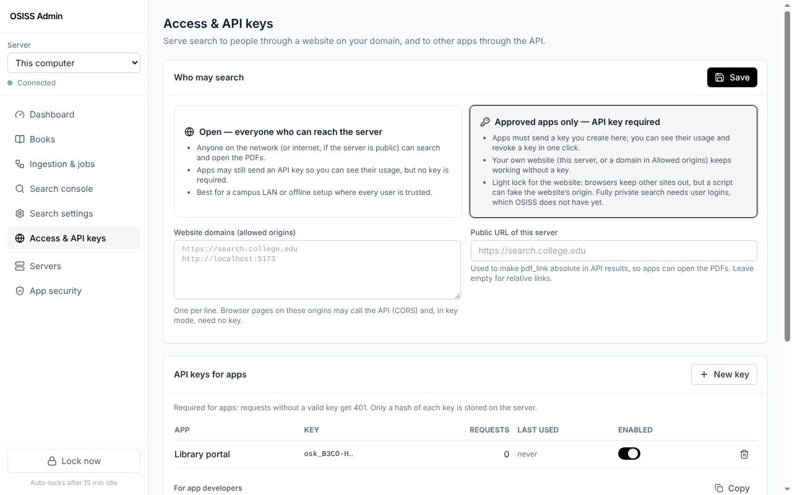

To give an app access:

1. Click **New key**, name the app and click **Create**.
2. Copy the key at once. The server stores only a fingerprint of it, so it can never be shown again.
3. Give the key to the app's developer together with the example shown under **For app developers**.

The switch next to a key pauses it; the bin deletes it. The list shows how often each app used its key and when.

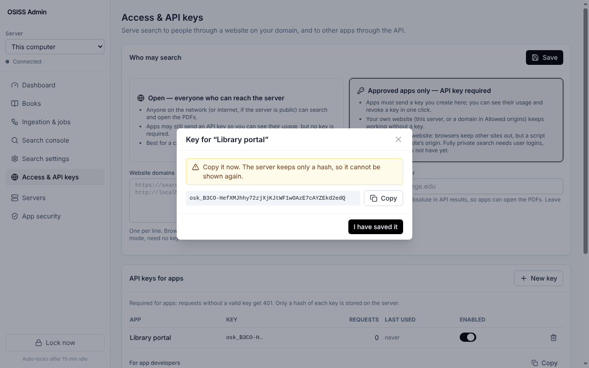

An app then searches like this (the response format is in [section 5](#api)):

```bash
curl -X POST https://ossis.com/api/search -H 'Content-Type: application/json' \
     -H 'X-API-Key: osk_…' -d '{"query": "What is thermodynamics?", "top_k": 3}'
```

#### 11.6.8 Lock the app, change the passkey or reset

* **Lock now** (bottom left) locks the app at once. It also locks itself after the idle time set under **App security →
  Auto-lock** (15 minutes by default).
* **App security → Change passkey:** get a new random passkey, or switch to a passphrase of 10 or more characters (stronger, and
  recommended on computers without an OS keychain).
* After 5 wrong passkeys the app refuses to unlock for 30 seconds, then 1, 2, 4… minutes (up to 15).
* **Forgot the passkey?** on the lock screen, or **Reset app**, deletes the saved servers on this computer and creates a new
  passkey. Nothing on the servers changes; add them again with their tokens.

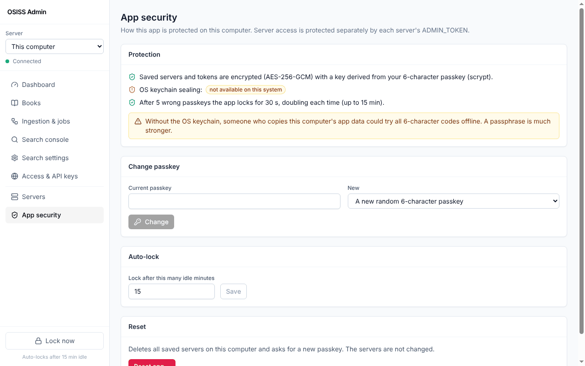

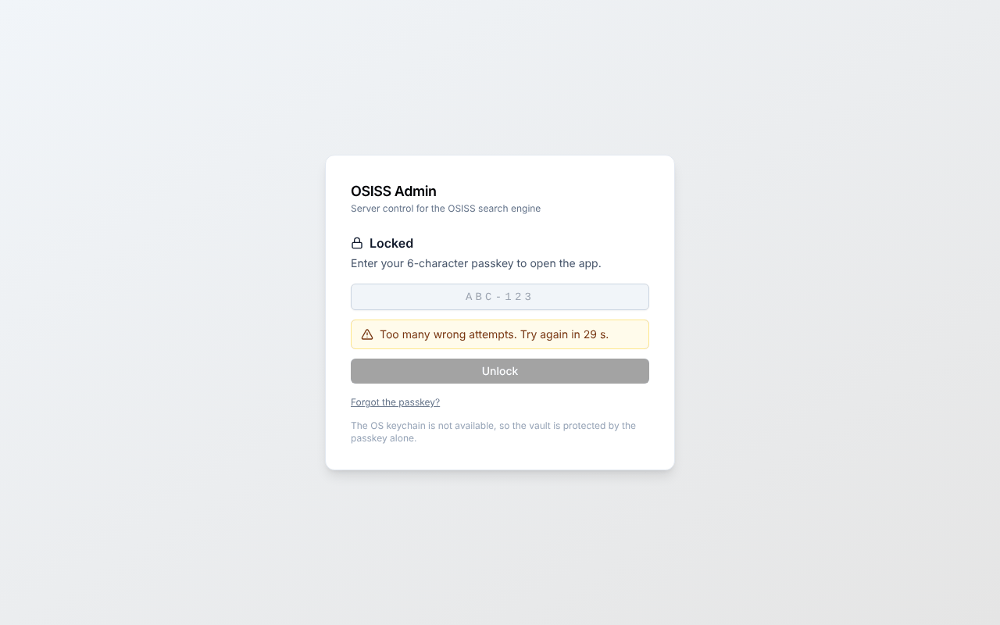

### 11.7 How the app and the server are protected

* **The app on a computer** is protected by the passkey. Saved servers and their admin tokens are encrypted with AES-256-GCM under
  a key derived from the passkey with scrypt. Where the OS keychain is available (Windows, macOS, Linux desktops with a keyring),
  they are also sealed with it, so copying the app's files to another computer is not enough to try passkeys there.
* **The server** is protected by its `ADMIN_TOKEN`:
  * every `/api/admin/*` call must carry it;
  * without one set, the admin API is switched off (503);
  * 10 wrong tokens from one address within 15 minutes block that address for 15 minutes;
  * `ADMIN_ALLOWED_IPS` and the Caddy example can limit admin calls to known addresses.
* **Tokens never reach the app's screens.** All server calls are made by the app's background process, which only talks to
  `/health` and `/api/admin/*`. It refuses plain `http://` to remote servers unless you tick the trusted-network option.
* **Treat the token like a password.** Anyone with `ADMIN_TOKEN` can change the library. To replace it:
  1. Edit `.env` on the server.
  2. Restart the API.
  3. Update the token under **Servers** in each admin app.

### 11.8 Capacity and load

Almost all the time of a search is spent running the models: the embedder, the reranker on about 30 passages, and the
answer-finding model on about 5. On the 12 GB GPU used for the evaluation that is about 2.3 s for an English question and about
4 s for a mixed one, with one person searching. One API process holds one copy of the models, so searches that arrive together
share it.

**What happens to a search**

1. **Rate limit (optional):** more than *Searches per minute per IP* (or *per API key*) gets `429 Too many searches`, with a
   `Retry-After` header. Off by default: on a campus network many people often share one address.
2. **Answer cache:** a question asked recently (same words, ignoring case and spacing, same number of results, same search
   settings) is answered from memory in milliseconds. Editing, deleting, adding, restoring or re-ingesting a book clears the cache
   at once. *Answer cache time* is the longest an answer is reused, which also covers books added by `ingestion.sh` in a separate
   process.
3. **Search queue:** at most `SEARCH_CONCURRENCY` searches (default 2) run the models at the same time. Up to *Search queue limit*
   more wait their turn in arrival order; beyond that, or after *Queue wait limit* seconds, the server answers
   `503 The server is busy` with a `Retry-After` header. Visitors then get a quick "try again" instead of a search that hangs, and a
   spike cannot run the GPU out of memory. The admin search console uses the same queue but is never cached.

The Dashboard's **Search load** card shows the last five minutes:

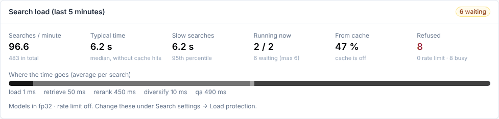

* **Searches / minute:** how busy the server is.
* **Typical time** and **Slow searches:** the median and 95th-percentile response time, without cache hits.
* **Running now:** how many searches are running and waiting.
* **From cache:** the share answered from the cache.
* **Refused:** how many searches were turned away (`429` rate limit, `503` busy).
* **Where the time goes:** the average time per stage.

The limits are under **Search settings → Load protection** and take effect at once:

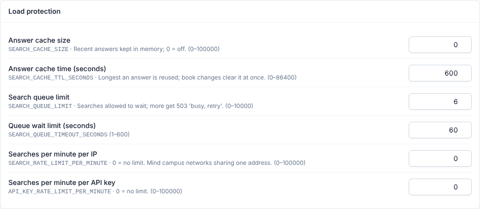

**Measuring your server**

1. In **Search settings → Load protection**, set *Answer cache size* to `0`, so the test measures the models and not the cache.
   Set it back afterwards.
2. Run the load test from any machine that can reach the server. Start with one simulated user, then raise the number:

   ```bash
   .venv/bin/python tests/load_test.py --url http://localhost:8000 --users 1  --duration 60
   .venv/bin/python tests/load_test.py --url http://localhost:8000 --users 5  --duration 60
   .venv/bin/python tests/load_test.py --url http://localhost:8000 --users 20 --duration 60 --admin-token "$ADMIN_TOKEN"
   ```

   Each user asks the 109 evaluation questions one after another. Add `--api-key osk_…` in "approved apps only" mode and
   `--json report.json` to keep the numbers.
3. Read the report. *answered … searches/s* is what the server sustains. When it stops growing as you add users, the models are
   the limit. The response times (p50, p95) are what visitors feel.

For illustration, a demo server where every search takes a simulated 1.24 s gave these results (your numbers will differ):

| Run (10 users) | Searches/s | Typical time (p50) | Refused |
|---|---|---|---|
| Cache off, 2 searches at once | 1.6 | 6.2 s | none |
| Cache off, queue limit 3 | 1.6 | 2.5 s | 10 × `503` busy |
| Cache off, rate limit 20 per minute | 1.0 | 6.2 s | 10 × `429` |
| Cache on, 90 s (questions start repeating) | 4.0 | 0.012 s | none |

With the models as the bottleneck, searches per second ≈ `SEARCH_CONCURRENCY` ÷ time per search, and each extra waiting user adds
to everyone's wait.

**What to change first**

1. **Half precision on a GPU** (`MODEL_PRECISION=fp16`, off by default). It is usually much faster but can change rankings
   slightly, so check accuracy first. Run the evaluation both ways:

   ```bash
   .venv/bin/python tests/eval_search.py --mode full --depth 3
   .venv/bin/python tests/eval_search.py --mode full --depth 3 --set model_precision=fp16
   ```

   If hit@3 and MRR stay within one or two questions, add `MODEL_PRECISION=fp16` to `.env` and restart the API. The CPU always uses
   full precision. With fp16 on, books uploaded from the admin app are embedded in half precision too; books ingested by
   `ingestion.sh` stay full precision. The difference for search is very small.
2. **Rerank batch size:** on a GPU try `32` (Search settings → Rerank batch size) and watch the GPU memory tile.
3. **Fewer candidates:** the reranker's work grows with *Retrieval candidates* (30). Try 20 and run the evaluation to see what it
   costs in accuracy.
4. **Keep the answer cache on.** Classes often ask the same questions.
5. **`SEARCH_CONCURRENCY`:** on a large GPU try 3 or 4 (in `.env`, restart). Keep the higher value only if the load test shows
   more searches per second; if only the response times grow, go back. On a CPU-only server use 1.
6. **Public site:** set *Searches per minute per IP* (e.g. 20) so one visitor or script cannot take every slot, and give apps
   their own limit per API key.

When the load test shows that even the tuned server cannot keep up, run several API copies behind a load balancer
([11.9](#119-running-several-copies)).

### 11.9 Running several copies

When the load test shows that one tuned server cannot keep up, or the site must stay up when one machine fails, run
several copies of the API behind a load balancer. Each copy has its own models (one GPU each) and its own search
queue. What they must agree on is shared:

| Shared | Through | Set on every copy |
|---|---|---|
| Admin-app settings and server state, the job queue and log, the admin lockout, the list of copies, the "books changed" signal that retires cached answers | PostgreSQL | `STATE_BACKEND=postgres` |
| The PDFs and staged uploads | one folder every copy mounts (NFS, EFS), or S3 | `STORAGE_BACKEND=local` with a shared `PDF_DIR` / `UPLOAD_DIR`, or `STORAGE_BACKEND=s3` + `S3_BUCKET` |
| Answer cache and exact rate limits (optional) | Redis | `REDIS_URL` |

Without Redis each copy keeps its own answer cache and counts rate limits on its own, so set the per-IP limit to the
total you want divided by the number of copies.

**One copy runs ingestion.** `INGEST_WORKER=true` on exactly one copy (the worker) and `false` on the search copies.
Any copy accepts uploads and shows jobs; the worker runs them, so OCR never slows down a search copy. Each job runs
once even if two workers are started by mistake.

**Every copy also needs** the same `ADMIN_TOKEN`, PostgreSQL and Elasticsearch, a unique `REPLICA_ID` (the name the
admin app shows), `WARMUP_ON_START=true` (load the models before taking traffic), and `FORWARDED_ALLOW_IPS` set to the
load balancer's address, so rate limits and the admin lockout see the visitors' addresses. The load balancer sends
traffic only to copies whose `GET /ready` answers 200.

**Option 1: one machine with several GPUs.** `deploy/docker-compose.replicas.yml` runs a worker and two search copies
(one GPU each) with PostgreSQL, Elasticsearch, optional Redis and Caddy in front:

```bash
cp deploy/replicas.env.example deploy/replicas.env          # set ADMIN_TOKEN, POSTGRES_PASSWORD, OSISS_SITE, ...
docker compose -f deploy/docker-compose.replicas.yml --env-file deploy/replicas.env up -d --build
docker compose -f deploy/docker-compose.replicas.yml --env-file deploy/replicas.env --profile redis up -d   # with Redis
```

The models come from `../models` (mounted read-only) or `MODELS_S3_URI`. Add a copy by duplicating a `search-N` block
and listing it in `deploy/Caddyfile.replicas`.

**Option 2: several machines on the campus network.** On each machine run `./api.sh` with a `.env` holding the shared
settings above, mount the same PDF folder (or use S3), and put Caddy in front with `deploy/Caddyfile.replicas`
(replace `search-1:8000 ...` with the machines' addresses). Each machine can use `deploy/osiss-api.service`.

**Option 3: AWS.** `deploy/aws/` creates the whole setup with Terraform: GPU copies that scale with demand, a worker,
RDS PostgreSQL, S3, Elasticsearch on EC2 or Elastic Cloud, optional Redis and WAF. Follow
[deploy/aws/README.md](deploy/aws/README.md), which also covers costs and removal.

**Watching the copies.** The Dashboard's Search load card shows the totals and one row per copy. A copy that stops
reporting is flagged, and the load balancer stops using it once its `/ready` check fails:

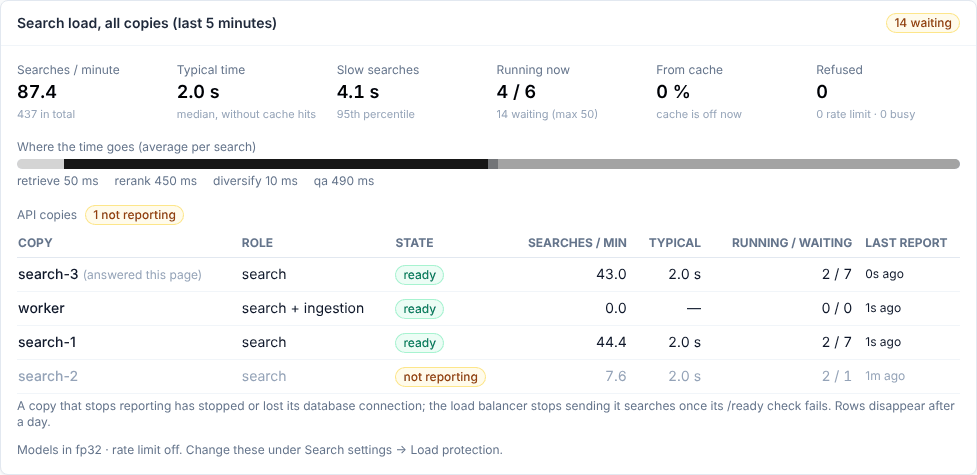

The Server card names the shared state, the PDF storage, Redis and the copy that answered; jobs show which copy ran them:

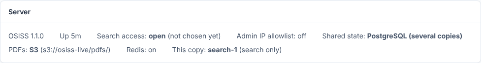

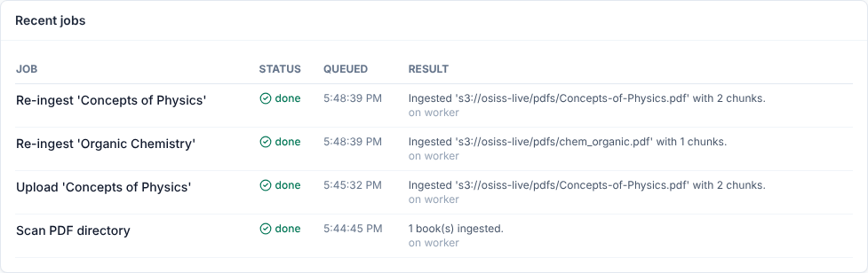

**What was tested.** The live test used 3 search copies plus a worker behind Caddy, PostgreSQL, Redis and an
S3-compatible store. Each search took a simulated 1 s; Elasticsearch and the models were stand-ins. The results:

* A setting saved through the load balancer reached all copies within 3 s.
* A scan and an upload queued on search copies ran once, on the worker. The uploaded PDF was served by a third copy
  through a signed S3 link.
* A title edit made through one copy retired the cached answer on the others.
* A rate limit of 6 per minute held exactly across all copies.
* Throughput rose from 2.0 to 6.0 searches/s (typical wait from 6.0 s to 2.0 s) going from one copy to three.
* Stopping a copy during a load test cost one request (the one it was answering). The copy was flagged in the admin
  app, and rejoined automatically after a restart.

**Limits.** `ingestion.sh` running as a separate process does not signal book changes to the copies' caches. Cached
answers then age out after *Answer cache time* instead of at once. Prefer the worker copy for ingestion.

---

## 12. Configuration reference

All settings are environment variables, read at import time into the frozen `Settings` dataclass in `src/config.py`.

### Search

| Variable | Default | Meaning |
|---|---|---|
| `HYBRID_MODE` | `rrf` | `rrf` fuses kNN and BM25 by rank; `sum` is the older single additive query |
| `RRF_K` | `60` | RRF constant $k$ |
| `RRF_KEYWORD_WEIGHT` | `1.0` | RRF weight of the BM25 list |
| `HYBRID_KEYWORD_BOOST` | `0.01` | BM25 multiplier in `sum` mode |
| `RETRIEVAL_CANDIDATES` | `30` | Chunks per retrieval list |
| `LANGUAGE_ANALYZERS` | `true` | BM25 also searches the language subfield (`text.bn`, `text.hi` or `text.en`) |
| `QUERY_STOPWORDS` | `true` | Strip question words from the BM25 query |
| `KEYWORD_SAME_LANGUAGE` | `true` | Bengali/Hindi queries keyword-match only same-language chunks |
| `RERANK_ENABLED` | `true` | Use the cross-encoder reranker |
| `DEDUPE_RESULTS` | `true` | One chunk per page, Jaccard dedupe |
| `MMR_LAMBDA` | `0.85` | MMR relevance/diversity trade-off (`1.0` = off) |
| `QA_EXTRA_CANDIDATES` | `2` | Extra chunks sent to QA beyond `top_k` |
| `QA_RANK_WEIGHT` | `0.3` | Weight $w$ of the QA score in the final score |
| `MIN_QA_SCORE` | `0.0` | Drop QA results below this score |
| `EXCLUDE_EXERCISES` | `true` | Hide exercise / question-bank chunks |

### Romanized queries

| Variable | Default | Meaning |
|---|---|---|
| `TRANSLIT_ENABLED` | `true` | Turn transliteration on or off |
| `TRANSLIT_MODEL_PATH` | `./models/Singla0009_all-indic-transliteration/indicxlit_ct2_fp32` | IndicXlit CTranslate2 model |
| `TRANSLIT_TOPK` | `3` | Candidate spellings per word (extra ones go to BM25 only) |
| `TRANSLIT_ORIGINAL_WEIGHT` | `0.5` | RRF weight of the query as typed |
| `TRANSLIT_CONFIDENCE` | `0.5` | Rerank-score threshold θ below which ambiguous queries get rewrites |
| `ENGLISH_VOCAB_PATH` | `./models/english_vocab.txt` | English word list (built by `src/build_english_vocab.py`) |

### Ingestion and OCR

| Variable | Default | Meaning |
|---|---|---|
| `PDF_DIR` | `./data/pdfs` | Folder watched for PDFs |
| `POLLING_INTERVAL_SECONDS` | `10` | Watch-mode poll interval |
| `CHUNK_SIZE_WORDS` | `300` | Words per chunk |
| `CHUNK_OVERLAP_WORDS` | `50` | Overlap between chunks |
| `MIN_CHUNK_WORDS` | `40` | Merge shorter trailing fragments |
| `OCR_LANGUAGE` | `eng` | Language for OCR of embedded images (normal path) |
| `OCR_FALLBACK` | `true` | Full-page OCR for unusable text layers |
| `OCR_DPI` | `300` | Render resolution for full-page OCR |
| `OCR_LANGUAGES` | `ben+hin+eng` | Tesseract languages used to probe a book's script |
| `OCR_WORKERS` | `8` | OCR threads (about 4 pages/s with 20) |

### Infrastructure and models

| Variable | Default |
|---|---|
| `POSTGRES_HOST`, `POSTGRES_PORT` | `localhost`, `5433` |
| `POSTGRES_DB`, `POSTGRES_USER`, `POSTGRES_PASSWORD` | `osiss`, `osiss`, `osiss` |
| `ELASTICSEARCH_URL`, `ELASTICSEARCH_INDEX` | `http://localhost:9200`, `osiss_chunks` |
| `MODELS_DIR` | `./models` |
| `BGE_MODEL_PATH` | `./models/BAAI_bge-m3` |
| `QA_MODEL_PATH` | `./models/deepset_xlm-roberta-large-squad2` |
| `RERANKER_MODEL_PATH` | `./models/BAAI_bge-reranker-v2-m3` |
| `EMBEDDING_DIM` | `1024` |
| `INFERENCE_DEVICE` | `auto` (`auto`, `cpu` or `cuda`) |

### Admin and access

| Variable | Default | Meaning |
|---|---|---|
| `ADMIN_TOKEN` | *(empty)* | Enables `/api/admin/*` and the in-process ingester; `setup.sh` generates one into `.env` |
| `ADMIN_ALLOWED_IPS` | *(empty = any)* | Comma-separated IPs / CIDRs allowed to call the admin API |
| `UPLOAD_DIR` | `./data/uploads` | Staging folder for uploaded PDFs |
| `UPLOAD_MAX_MB` | `500` | Largest accepted upload |
| `SETTINGS_OVERRIDES_PATH` | `./data/admin/settings_overrides.json` | Settings saved from the admin app |
| `SEARCH_ACCESS` | *(empty = open, not chosen)* | `open` or `key`; normally chosen in the admin app |
| `CORS_ORIGINS` | *(empty)* | Comma-separated website origins allowed to call the API |
| `PUBLIC_BASE_URL` | *(empty)* | Makes `pdf_link` absolute, e.g. `https://search.college.edu` |
| `SERVE_FRONTEND` | `false` | Serve `frontend/dist` at `/` |
| `API_HOST`, `API_PORT` | `0.0.0.0`, `8000` | Where `api.sh` listens; `127.0.0.1` behind a reverse proxy on the same machine |

### Load and performance

| Variable | Default | Meaning |
|---|---|---|
| `MODEL_PRECISION` | `fp32` | `fp16` or `auto` run the models in half precision on a GPU (the CPU always uses fp32) |
| `RERANK_BATCH_SIZE` | `8` | (query, passage) pairs per reranker pass |
| `SEARCH_CACHE_SIZE` | `1000` | Recent answers kept in memory; `0` turns the cache off |
| `SEARCH_CACHE_TTL_SECONDS` | `600` | Longest an answer is reused (book changes clear the cache at once) |
| `SEARCH_CONCURRENCY` | `2` | Searches running the models at the same time |
| `SEARCH_QUEUE_LIMIT` | `50` | Searches allowed to wait; more get `503` |
| `SEARCH_QUEUE_TIMEOUT_SECONDS` | `60` | Longest wait in the queue before `503` |
| `SEARCH_RATE_LIMIT_PER_MINUTE` | `0` | Searches per minute per client IP (`0` = no limit); over the limit `429` |
| `API_KEY_RATE_LIMIT_PER_MINUTE` | `0` | Searches per minute per API key (`0` = no limit) |

See [11.8](#118-capacity-and-load) for how to measure and tune these.

### Several copies, storage and managed services

| Variable | Default | Meaning |
|---|---|---|
| `STATE_BACKEND` | `local` | `postgres` shares settings, jobs, log, lockouts and the copies list between API copies ([11.9](#119-running-several-copies)) |
| `SETTINGS_SYNC_SECONDS` | `5` | How often a copy picks up settings saved through another copy |
| `INGEST_WORKER` | `true` | Whether this process runs ingestion jobs and polling (`false` on search-only copies) |
| `REPLICA_ID` | host name + process id | Name of this copy in the admin app |
| `REPLICA_HEARTBEAT_SECONDS` | `15` | How often a copy reports; three missed reports mark it as not reporting |
| `WARMUP_ON_START` | `false` | Load the models at start; `/ready` then answers 200 only once they are loaded |
| `REDIS_URL` | *(empty)* | e.g. `redis://host:6379/0`: answer cache and exact rate limits shared by all copies |
| `STORAGE_BACKEND` | `local` | `s3` keeps PDFs and staged uploads in S3 |
| `S3_BUCKET`, `S3_PREFIX`, `S3_UPLOAD_PREFIX` | *(empty)*, `pdfs/`, `uploads/` | Where in S3 |
| `S3_REGION`, `S3_ENDPOINT_URL` | *(empty)* | Region; endpoint for S3-compatible stores (MinIO, ...) |
| `PDF_SERVE_MODE` | `redirect` | S3 PDFs: `redirect` to a short-lived signed URL, or `proxy` through the API |
| `S3_URL_EXPIRY_SECONDS` | `900` | Lifetime of those signed URLs |
| `POSTGRES_SSLMODE`, `POSTGRES_SSLROOTCERT` | *(empty)* | TLS to a managed database, e.g. `require` for RDS |
| `ELASTICSEARCH_API_KEY` | *(empty)* | Secured cluster (Elastic Cloud); or `ELASTICSEARCH_USERNAME` + `ELASTICSEARCH_PASSWORD` |
| `ELASTICSEARCH_CA_CERTS`, `ELASTICSEARCH_VERIFY_CERTS` | *(empty)*, `true` | TLS to Elasticsearch |

The container image (`Dockerfile`, `deploy/docker-entrypoint.sh`) also reads `MODELS_S3_URI` (fetch `models/` from S3
at start; see `src/sync_models.py`), `DOWNLOAD_MODELS=true`, `RUN_DB_INIT=true` (create the schema and index; set it on
one container) and `FORWARDED_ALLOW_IPS` (the load balancer's address, whose `X-Forwarded-For` is trusted).

Settings marked as runtime-editable in the admin app (search knobs, `RERANK_BATCH_SIZE`, the load-protection limits,
`POLLING_INTERVAL_SECONDS`, `SEARCH_ACCESS`, `CORS_ORIGINS`, `PUBLIC_BASE_URL`) can be overridden from `settings_overrides.json`,
which wins over the environment. `MODEL_PRECISION` and `SEARCH_CONCURRENCY` need a restart.

---

## 13. Project structure

```
src/
  api_server.py            FastAPI app: /health, /api/search, /data PDFs, search access + CORS
  admin_api.py             /api/admin/* routes (token auth, lockout, IP allowlist)
  admin.py                 book metadata, delete/restore, API keys (PostgreSQL + Elasticsearch)
  ingest_worker.py         in-process ingestion worker: jobs, polling, maintenance scripts, log
  runtime_config.py        settings the admin app may change at runtime, persisted overrides
  db_pool.py               PostgreSQL connection pool for the API
  load_control.py          answer cache, rate limiter, search queue and load metrics (Redis-backed when REDIS_URL is set)
  job_store.py             ingestion job queue and log: in memory, or shared in PostgreSQL
  storage.py               where PDFs live: local folder or S3 (staging, signed links, local copies for OCR)
  replica.py               this copy among several: name, heartbeat with metrics, /ready, model warm-up
  sync_models.py           copies models/ to or from S3
  search.py                search pipeline: retrieve, fuse, rerank, diversify, QA, quote extraction
  ranking.py               model-free helpers: query cleanup, RRF, MMR, dedupe, QA windows
  translit.py              romanized-query detection and IndicXlit transliteration
  ingest.py                ingestion pipeline (watcher or --once, --only)
  utils.py                 PDF extraction, OCR fallback, chunking, language and exercise heuristics
  config.py                all settings (environment variables)
  db_init.py               PostgreSQL schema and Elasticsearch mapping
  clients.py               Elasticsearch / PostgreSQL clients with retries
  download_models.py       downloads models into models/
  build_english_vocab.py   builds models/english_vocab.txt
  reindex_es.py            fills language subfields on existing documents
  backfill_exercise_flags.py  re-applies the exercise heuristic in place
  wait_for_services.py     waits for Postgres and Elasticsearch
frontend/                  React + TypeScript + Tailwind UI
  src/components/ResultCard.tsx   result card with highlighted paragraph
  src/lib/searchApi.ts            API client and response normalisation
  src/lib/textFormat.ts           display cleanup and quote/answer highlighting
admin/                     Electron admin app (React + TypeScript + Tailwind)
  electron/main.ts                window, IPC, all server calls (adds the admin token)
  electron/vault.ts               passkey vault: scrypt + AES-GCM + OS keychain, lockout
  electron/localControl.ts        docker compose / api.sh control for a server on this computer
  src/pages/                      Dashboard, Books, Ingestion, Search console, Settings, Access, Servers, Security
tests/
  eval_search.py           evaluation harness (hit@k, MRR, nDCG, per-group, latency, --compare)
  eval/questions.json      109 labelled questions
  load_test.py             load test: simulated concurrent users against a running server
  test_*.py                unit tests (no services needed)
docs/
  results.json             every number behind the tables and graphs in this README
  make_figures.py          regenerates docs/images/*.png from results.json
  images/                  the graphs
  images/admin/            admin app screenshots used in section 11
data/pdfs/                 source PDFs (git-ignored)
models/                    local model cache (git-ignored)
docker-compose.yml         Postgres + Elasticsearch (published on 127.0.0.1 only)
Dockerfile                 API image (website built in, Tesseract with ben/hin, /ready health check)
deploy/
  Caddyfile.example        HTTPS reverse proxy for a public domain, admin API limited to the admin's IP
  osiss-api.service        systemd unit: start the API at boot, restart it if it stops
  docker-entrypoint.sh     container start: fetch models, optional schema init, run the API
  docker-compose.replicas.yml, Caddyfile.replicas, replicas.env.example   several copies on one machine
  aws/                     Terraform for AWS (guide: deploy/aws/README.md; terraform test with a mocked provider)
setup.sh, ingestion.sh, api.sh   bootstrap and runner wrappers
```

---

## 14. Testing and reproducing the results

```bash
# unit tests (no services needed). The env var avoids system ROS pytest plugins that crash collection.
# test_admin_db.py, test_replicas_db.py and the ingestion part of test_storage_s3.py use a throwaway `osiss_test`
# database and are skipped when PostgreSQL is not reachable; test_storage_s3.py fakes S3 with moto and test_redis.py
# starts a local redis-server (skipped if not installed): pip install moto fakeredis
PYTEST_DISABLE_PLUGIN_AUTOLOAD=1 .venv/bin/python -m pytest tests

# AWS configuration: validated and planned against a mocked AWS provider (no account needed)
cd deploy/aws && terraform init -backend=false && terraform test

# admin app: vault, profile rules and local process control (Node 22), then lint, typecheck and build
cd admin && npm test && npm run lint && npm run build

# load test against a running server (see 11.8); tests/test_load.py covers the cache, limits and queue without services
.venv/bin/python tests/load_test.py --url http://localhost:8000 --users 10 --duration 60

# evaluation (needs Postgres, Elasticsearch and the PDFs ingested)
.venv/bin/python tests/eval_search.py --validate               # check labels against ingested text
.venv/bin/python tests/eval_search.py --mode full --depth 3    # full pipeline, as the API serves it
.venv/bin/python tests/eval_search.py --mode retrieval         # retrieval only
.venv/bin/python tests/eval_search.py --compare --mode retrieval   # feature ablation table
.venv/bin/python tests/eval_search.py --mode full --set translit_confidence=0.8   # override any setting

# regenerate the graphs in this README
pip install matplotlib
python docs/make_figures.py
```

The tests cover ranking maths, search with a fake Elasticsearch client and fake models, the OCR fallback decision, transliteration gating and the confidence fallback.
Running the evaluation while the API server is up can run out of GPU memory on a 12 GB card; stop the API or use `INFERENCE_DEVICE=cpu` for retrieval-only runs.

---

## 15. Troubleshooting

* **Docker permission denied:** add your user to the `docker` group and log in again, or run setup with sudo.
* **Missing Python modules when running scripts:** use the wrappers (`./ingestion.sh`, `./api.sh`) or activate `.venv`.
* **Stale API behaviour:** `pkill -f "uvicorn src.api_server:app" || true && ./api.sh`.
* **CUDA out of memory:** another process (often the API server) holds the GPU; stop it or set `INFERENCE_DEVICE=cpu`.
* **Frontend build fails with `CustomEvent is not defined`:** Node is too old for Vite 8; use Node 20.19+ or 22.12+.
* **Garbage Bengali/Hindi text after ingestion:** the OCR language packs are missing (`tesseract --list-langs` must show `ben` and `hin`), or `OCR_FALLBACK=false`.
* **Romanized queries behave like English:** the transliteration model is missing (`python src/download_models.py`) or `TRANSLIT_ENABLED=false`.
* **Admin app says "Admin API is disabled":** set `ADMIN_TOKEN` in `.env` and restart `./api.sh`.
* **Admin app gets 429:** too many wrong admin tokens from that address; wait 15 minutes or fix the token under *Servers*.
* **Behind a reverse proxy, `ADMIN_ALLOWED_IPS` sees the proxy's address:** uvicorn only trusts `X-Forwarded-For` from `127.0.0.1` by default (`FORWARDED_ALLOW_IPS`).
* **Several copies: a setting changed on one copy does not show on another:** all copies need `STATE_BACKEND=postgres` and the same database; changes arrive within `SETTINGS_SYNC_SECONDS`.
* **Several copies: uploads stay "queued":** no copy runs with `INGEST_WORKER=true`, or it cannot reach the shared PDF storage (check its log in the admin app's live log).
* **The load balancer sends no traffic to a copy:** `curl http://<copy>:8000/ready` shows which check fails (Elasticsearch, database, or models still loading with `WARMUP_ON_START=true`).

---

## 16. Roadmap

1. ~~**Metadata and admin app**~~ — done: see [section 11](#11-using-the-admin-app-step-by-step). Next: fix the existing guessed titles with it, and add
   user logins if search must be private while a public website is up.
2. **A trustworthy accuracy number:** 50–100 natural questions written independently in all three languages.
3. **Cross-language retrieval:** the language-mismatch BM25 rule and a reranker blend ([8.6](#86-experiment-soft-bm25-weight-for-cross-language-questions)), validated on a larger cross-language set.
4. **Quote quality:** better sentence splitting around section numbers and a fallback when the QA span is a fragment.
5. **More books and OCR quality checks** for Bengali/Hindi conjuncts.
6. ~~**Scaling out for heavy public traffic**~~ — done: several API copies sharing state through PostgreSQL, S3 storage,
   optional Redis, and an AWS deployment ([11.9](#119-running-several-copies)). Next: apply the AWS configuration to a real
   account and measure real GPU throughput.

---

## 17. Licenses

This project is open source and intended for academic and institutional deployment. Dependencies keep their own licenses; please check them before redistributing or deploying commercially. In particular:
**PyMuPDF** is AGPL-3.0 (or commercial), **Elasticsearch 8.10** is under the Elastic License 2.0 / SSPL, and `deepset/xlm-roberta-large-squad2` is CC-BY-4.0 (attribution required). The embedder (MIT), reranker (Apache-2.0),
transliteration model (MIT), Tesseract (Apache-2.0), React / Vite / Tailwind (MIT) and the Python libraries listed in [section 3](#3-tech-stack-libraries-and-models) carry permissive licenses.
